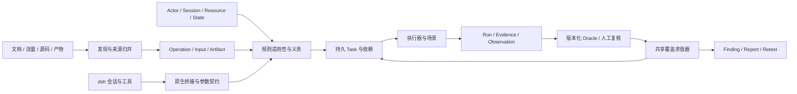
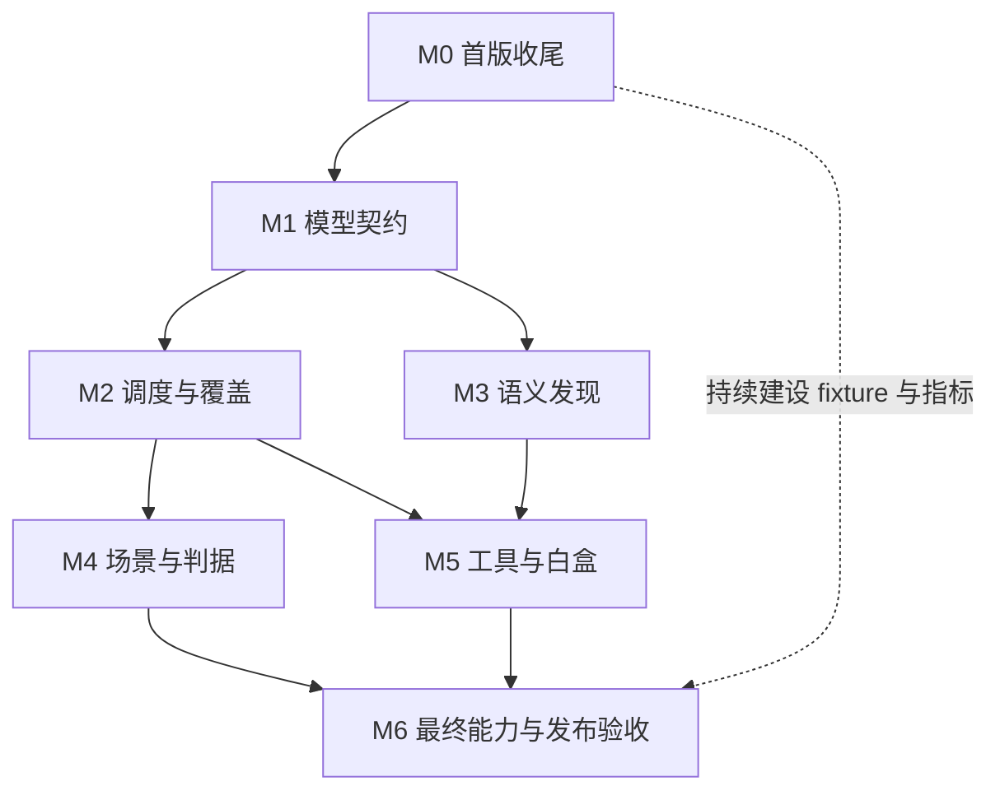

# awa-ddd 详细开发计划

> 历史本地产物说明：文中的 `.validation` 备份、日志和旧包不随仓库交付，旧副本已清理；不是当前构建依赖或验收结果。当前验证见 [README](../README.md)。

> 本文件保留 2026-10-25 的历史规划与验收基线；0.4.0 的本轮实现、工具通信记录和用户要求停止测试的状态，以 [UPGRADE-20261026.md](UPGRADE-20261026.md) 为准。版本号不表示所有历史里程碑已完成。

日期：2026-10-25。计划版本：1.0。适用代码基线：当前 `awa-ddd@0.1.0` 工作区。

本计划依据升级评审、指定历史对话、pentest-pro 与 ARTEX 的实现研究，以及已经落地的 awa-ddd 代码制定。目标是将现有首版推进为可以验证、交付和持续扩展的 dsh 原生安全评估插件。阶段、版本号、工期均为开发规划；“已有实现”和“通过某项检查”按下文证据口径记录。

## 1. 当前起点与交付目标

### 1.1 已核实的开发基线

| 项目 | 当前事实 | 对计划的影响 |
|---|---|---|
| 插件结构 | 8 组 dsh 工具、28 个 action + 1 个会话级渗透模式（服务端投影 + 输入栏按钮），Node 桥接本地 Python/SQLite | 继续使用现有入口，优先完善内部契约 |
| 模型与存储 | operation/actor/session/resource/obligation/run/evidence/decision/finding/candidate；SQLite 事务、追加事件、不可变证据文件 | 可扩展，不需要重新搭建整个工程 |
| 发现 | OpenAPI、JavaScript AST、HAR、ARTEX、SARIF 五种离线导入 | 深化语义与归并，补齐来源版本与未解析任务 |
| 线索台账 | candidate 稳定 ID、分页、link/dismiss/reopen；关联不产生证据或义务 | M3-04 主体已落地，后续补来源变化重开 |
| 执行 | 有界 HTTP、请求幂等键、1–25 步场景、提取/断言、run.inspect/recover | 缺通用资源生命周期、任务租约、浏览器与外部工具生命周期 |
| 判据 | baseline、authorization、semantic_negative、有限 state_invariant；人工复核单独标记 | 需版本化规则与观察器、扩展类别判据及有效负控 |
| 覆盖与报告 | 计划/覆盖/报告共用 evaluator；gap 带稳定 `gap_id`/`reason_code`/`next_action`，旧项目导入保持未验证来源 | 需补完整依赖图、增量 revision、交付/复测快照 |
| Python 回归 | 108 项全部通过（新增 candidate 17 项、gap 10 项） | 记录见本地 `.validation/` |
| Node 回归 | 19 项通过（含 candidate 组只读分类） | 已覆盖 SDK schema、桥接边界、取消和部分进程故障 |
| 本次运行环境 | Windows；Python 3.13.3；Node 24.21.0；npm 11.19.0 | Python 3.10+ / Node 22.19+ 是当前声明范围，不能视作每个版本都已实测 |
| 业务演示 | 先前回环演示中 8 次请求、8 条证据、18 项自检；漏洞/修复/登录页干扰分别 confirmed/refuted/inconclusive | 是公开真值演示；完整最终版本还需重新运行并绑定清单 |
| 包验证 | 已有一次打包→解包→真实 SDK 定义→包内 Python/SQLite/发现/报告验证 | 注册 context 是测试替身，直接调用 definition.execute；尚未验证真实桌面 ToolRuntime/PTC |
| 现存安装包 | `.validation/awa-ddd-0.1.0.tgz` 与当前 `engine.py`、`assessment.py` 不一致 | M0 重新打包并绑定最终文件摘要；当前归档不能代表最新修复 |
| 版本管理 | 当前目录未发现 Git 仓库 | 先保存文件摘要和阶段记录；后续建立版本基线，不伪造提交号 |

当前代码、测试及包元数据共 23 个文件的摘要清单保存在 `.validation/development-plan-source-manifest.json`，其聚合摘要为：

```text
2b3a3838af9235a756da360aaa1e97009c075b52195089d2c67998231d258222
```

该摘要绑定本次计划的实现起点，不覆盖未来修改。`package-lock.json` 默认不进入 npm tarball，此项与业务源文件不一致分别记录。`.validation` 是本地验证产物，不随插件分发；安装到其他环境后应重新生成对应清单。

### 1.2 产品目标

最终交付应支持以下可追溯流程：

```text
业务目标/范围 → 多源发现 → 操作与输入 → 身份、资源和状态前提
→ 测试义务 → 持久任务 → 实际执行 → 原始证据/观察
→ 类型化结论或人工复核 → 发现、覆盖、报告与复测
```

具体目标：

1. **测试正确**：实际请求身份、资源、业务参数、控制组和观察器能支撑所声称的结论。
2. **覆盖可解释**：每项完成、未决、受阻和不适用都有版本化依据；坏证据会产生可执行修复任务。
3. **发现更深入**：API 文档、前端请求、服务端路由、源码分析和构建产物线索能关联同一业务操作。
4. **运行可恢复**：任务可认领、取消、超时和恢复；模型中断后依然能从数据库和证据继续工作。
5. **能力可比较**：在相同模型、身份、工具和预算下，测量相对 pentest-pro 的发现变化、误确认和成本。
6. **安装可复现**：从最终包在隔离宿主环境完成真实工具调用，升级保留已有评估，发布声明与实测矩阵一致。

首个稳定版覆盖 Web/HTTP、命名 GraphQL 操作、浏览器客户端实验、一个服务端源码 profile、前端 bundle/source map 和一个经过验收的外部工具适配器。APK、原生服务二进制、WebSocket/RPC/gRPC、桌面/固件等作为明确的后续 profile。

### 1.3 与两个参考项目的关系

| 来源 | 吸收内容 | 接入方式 |
|---|---|---|
| pentest-pro | 精确输入身份、原始字节取证、范围控制、有效负控、单项交付与复测经验 | 按新对象模型实现或通过适配层消费；历史数据保持可追溯 |
| ARTEX | 探索对象关系、任务认领、持久活动、执行完成后唤醒规划、成本统计 | 在本地 Task/Run/事件机制中实现；fact 数量仅用于活动统计 |
| 指定历史对话 | 对融合、dsh 插件和外部工具的需求；限流/上下文中断经验 | 固化恢复、版本、证据和评测要求，详见 [SESSION_LESSONS](SESSION_LESSONS.md) |
| dsh | 模型、会话、工具调用、宿主生命周期 | 保留原生插件方式；根据实际 SDK 实现扩展能力 |

当前新实现未直接打包原项目代码树。未来引入代码、规则或资源时，登记来源、版本、许可证及修改范围。ARTEX 的许可证义务与本项目 MIT 声明需要逐项核对，不能因“融合”忽略第三方分发条件。

## 2. 原评审问题到开发任务的映射

“局部落实”表示已有相关实现和回归，仍有未完成的场景或平台范围。原评审里的测试数量、目标记录和旧项目问题不直接算作 awa-ddd 的当前测试成绩。

| 评审项 | awa-ddd 当前状态 | 本计划落实位置 | 关闭条件 |
|---|---|---|---|
| F01 浏览器 Cookie 身份切换 | 指引已采用独立身份原则；没有浏览器执行器 | M4-02、M4-03 | 真实浏览器独立 context + 服务端身份断言；同角色账号不串号 |
| F02 同角色会话覆盖 | HTTP actor/session 分离及换代已实现 | M1-03、M4-01 | HTTP/浏览器/刷新全路径保持主体一致，凭据变化使旧验证失效 |
| F03 操作权限缺口 | 按操作生成匿名、允许主体基线和受限主体义务；缺账号有 setup 项 | M2-01、M2-02 | 管理操作无归属维度时仍需匿名/低权限对照，缺失不会消失 |
| F04 过期身份仍被接受 | TTL、验证证据、generation 检查已实现 | M1-03、M4-01 | 登录态/权限变化能及时失效并关联刷新或修复任务 |
| F05 消费点未知与虚假 tested | 未知输入保持 input_review，输入变化产生新义务 | M1-02、M2-01、M3-04 | 未知、不适用、已执行、有效结论分别计数；支持分支和类别适用性 |
| F06 门禁与 next 断层 | 已共享 evaluator，坏证据形成 gap | M2-02、M2-04 | 所有阻塞/失效 gap 都能关联下一任务或明确外部依赖 |
| F07 OpenAPI 请求体遗漏 | 已有本地 ref、请求体、嵌套与组合支持 | M3-01、M6-01 | 固定支持集方法/位置/字段正确；不支持构造保留任务与统计 |
| F08 JS 方法/字段丢失 | 有限 AST、常量传播、fetch/axios；未解析线索进入 candidate 台账并可关联/驳回 | M3-02 | 扩展模块、封装、TS 后以真值样本公布正确绑定和未解析数 |
| F09 地址代替业务操作 | 已分命名 GraphQL/媒体类型；无通用协议模型 | M1-02、M3-05、后续 profile | 同端点多操作、变体与传输身份分开，协议声明不等于执行支持 |
| F10 运行时标签/噪声负控 | 已拒绝假 runtime 标签、未变化输入、部分噪声和不一致对照 | M1-04、M4-04、M4-05 | 各类型绑定有效观察器、控制和适用性，结论可按版本重放 |
| F11 场景/状态/竞态不足 | 有有界 HTTP 场景和有限状态判据 | M4-01 至 M4-06 | 资源生命周期、跨操作状态、浏览器及竞态都有正常/实验/清理对照 |
| F12 源码与逆向到实验 | SARIF 线索导入已实现；没有实际分析器/逆向执行器 | M5-01、M5-02、M5-04、后续 profile | 至少一条服务端源码及一条 bundle 线索贯通动态证据 |
| F13 工具全生命周期 | 原生工具组可调用；无外部扫描任务适配 | M2-03、M5-03、M5-04 | discover/execute/parse/confirm 分层，取消/部分结果/去重可验证 |
| F14 能力评测与发布 | 有契约回归、回环演示和部分包验证 | 从 M0 持续建设，M6 验收 | 隐藏保留集、同预算对照、真实宿主与支持平台安装通过 |

## 3. 目标架构与关键设计决定

### 3.1 模块结构

先维持现有入口与 Python 包，在模块有清晰接口和回归后逐步拆分。以下是目标结构，不要求一次移动全部文件。

```text
src/                         dsh 入口、工具 schema、桥接、宿主生命周期
awa_ddd/
  surface/                   操作/输入/来源及多源归并
  identity/                  actor、session、credential reference、身份观察
  planning/                  规则适用性、义务、gap 和预算优先级
  execution/                 task、租约、调度、取消、恢复
  scenarios/                 前置资源、变量、步骤、观察和清理
  evidence/                  原始材料、观察事件、完整性与版本关系
  oracles/                   按类别实现判据与控制验证
  adapters/                  HTTP、浏览器、MCP、源码/产物工具
  reporting/                 发现、快照、差异、复测与旧数据迁移
  storage/                   SQLite 事务、迁移、索引、版本与事件
rules/                       版本化规则包及标准映射
schemas/                     桥接与领域对象 schema
examples/                    可分发的合成示例
tests/                       契约、回环、业务、故障、宿主与安装测试
benchmarks/                  公开基准；独立保留集另行隔离
docs/                        契约、能力矩阵、发布与开发记录
```

任何文件迁移同步更新 npm 文件集、Python 包配置、引用与包内执行测试。内部模块化不改变模型使用的工具组，必要的协议变更采用显式版本。



### 3.2 数据对象与不变量

| 对象 | 关键字段/关联 | 必须保持的约束 |
|---|---|---|
| ProjectRevision | project_id、revision、scope_digest、ruleset/toolchain versions | 增量发现创建可追溯 revision；旧交付可按原版本解释 |
| Artifact/Source | computed_sha256、declared_sha256、format、path/commit、tool_version | 实际读取摘要与外部声明分开；未经读取核验的声明不变成实测事实 |
| TransportEndpoint | origin、path_template、method、transport | 实际请求目标和范围校验始终绑定真实传输地址 |
| Operation/Input | endpoint、protocol_name、media_type、variant；location/selector/branch | 同名不同位置、schema 分支与业务操作不合并；变化可使依赖失效 |
| Actor/Session | subject、tenant、roles；actor_id、generation、credential_ref、verification_run | 会话不能跨主体重绑；凭据载体和优先级明确；验证绑定实际主体 |
| Resource/State | resource_id、owner、tenant、lifecycle_id、operation_bindings、state_version | 资源可关联创建/读取/变更/清理多个操作；有效性须有观察依据 |
| TestCase/Rule | rule_id/version、applicability、preconditions、controls、observer、oracle | 用例定义、执行结果及覆盖状态分开；不能只有字符串类别 |
| Obligation/Gap | stable_id、revision、rule、operation/input、actor relation、resource/state | 去重包含实验语义；缺能力、缺身份、未知消费点持续可见 |
| Task | obligation_id、case_version、dependencies、lease_owner、lease_token、deadline、budget | 认领与状态转换为 CAS；旧租约/迟到结果不能覆盖新状态 |
| Run/Evidence | task_id、attempt、session_generation、request binding、artifact hashes | 证据与一次具体尝试绑定；文件写完和数据库提交之间的中断可恢复 |
| Observation | observer_type/version、time_window、nonce、subject、resource、evidence_refs | 浏览器、回调、状态读回与普通 HTTP 有不同有效性条件 |
| Decision | outcome、oracle_version、rule_version、supporting_runs、limitations | 正向/负向结论各自满足控制要求；人工结论带 reviewer，不冒充机器验证 |
| Delivery/Retest | revision、finding_versions、snapshot_digest、environment manifest | 报告固定历史时点；当前有效性、历史结论及复测变化分别显示 |

### 3.3 执行和结论状态

任务状态：`pending → ready → running → succeeded / failed / cancelled / interrupted`；等待前提使用 `blocked`。任务成功仅代表执行流程完成。

结论状态：`confirmed / refuted / inconclusive`。义务状态由求值器派生为 `open / blocked / evaluated / not_applicable / superseded`；`superseded` 表示旧版本退出当前分母，仍保留历史。

恢复时同时检查持久 run、证据、资源状态、会话版本与租约。只读且具幂等语义的操作可按统一预算重试；未知副作用的写操作先执行状态核对。重试、轮询和故障恢复共用项目预算，不创建无限新预算。

### 3.4 必须先确定的边界

- **身份载体**：Cookie、Bearer、自定义身份头、浏览器状态和其优先级显式建模。当前已禁止覆盖已登记 session 头；后续不能靠枚举敏感头名推断所有认证方式。
- **操作效果**：为 `read_only / test_resource_write / unknown` 建立带依据的效果分类。当前所有 POST 按写处理；支持 GraphQL query 或登录前必须先处理语义和资源前提。
- **观察器能力**：工具是否能执行与是否能支持某个判据分别登记。缺观察器形成受阻义务，不让一般 HTTP 或文本日志替代运行时证明。
- **覆盖口径**：发现规模、有效实验、候选数量和漏洞召回分别计数。unknown/blocked 保留在适用分母；N/A 要有业务事实和证据。
- **本地可恢复性**：先实现单机多个 worker 的正确性。持续浏览器/MCP 会话由明确归属的工作进程管理，生命周期与 dsh 取消相连；不依赖每次桥接进程都保存长连接。
- **判据重放**：原始字节不变；规范化/过滤噪声是版本化派生视图。重算使用记录的版本，升级判据另存新决定。

## 4. 里程碑、依赖与工作量

工期是熟悉现有工程的工程师投入，包含对应开发、回归和文档。各里程碑已合并跨模块工作，不再叠加各专方向的估算。正式排期应在 M0 与 M1 后按数据规模、宿主接口和 fixture 成本校准。

| 阶段 | 目标版本建议 | 主要交付 | 依赖 | 预计人日 |
|---|---|---|---|---:|
| M0 当前首版收尾 | 0.1.x | 可信基线、文档/包一致、已知反例回归、最小宿主派发、发布记录 | 现有代码 | 3–5 |
| M1 版本化统一模型 | 0.2.x | revision、artifact、rule/observation、身份/资源契约与迁移 | M0 | 8–12 |
| M2 覆盖与持久执行 | 0.3.x | 统一 gap、Task DAG、租约、恢复、预算和事件 | M1 | 10–15 |
| M3 语义发现 | 0.4.x | API/JS/TS深化、来源归并、未解析任务、协议操作边界 | M1；任务落地依赖 M2 | 12–18 |
| M4 实验与浏览器 | 0.5.x | 身份刷新、跨操作资源场景、浏览器、类别判据与竞态 | M1、M2；可与 M3 部分并行 | 20–30 |
| M5 工具与白盒闭环 | 0.6.x | 一个源码 profile、bundle/source map、一个 MCP 工具、动态归因 | M2、M3；动态闭环依赖 M4 | 18–28 |
| M6 对照评测与稳定发布 | 1.0 候选 | 隐藏真值基准、真实宿主、干净安装、迁移/复测验收 | 基准从 M0 开始；最终依赖 M4、M5 | 12–20 |
| 合计 | | 首个明确范围的稳定版 | | **83–128** |

不计额外风险约 17–26 人周；加约 20% 集成与环境余量后约 100–154 人日。该范围与原评审 17–28 人周属于相近粒度估算；真实宿主兼容、语言分析深度和评测规模扩大时需重估。APK/原生二进制和更多协议扩展未计入。

若有三名工程师，建议分别负责“核心模型/调度”“发现/工具”“场景/判据”，共享回归与发布责任。日历时间取决于关键依赖，不能直接将总人日除以人数作承诺。验收人员尽量独立于保留集设计与执行者。



## 5. 分阶段工作包

每个工作包完成后，在开发记录中附变更文件、验证命令、fixture、实际结果和未决问题。任务状态使用 `待开始 / 进行中 / 待验收 / 完成 / 受阻`，引用本节稳定 ID。当前以下工作包是待开发或待正式验收，包含对已有部分实现的补全。

### M0：当前首版收尾

| ID | 工作与主要位置 | 可交付物 | 验收标准 |
|---|---|---|---|
| M0-01 | 固定源码/依赖/规则与参考资料版本；核对 package、Python 和文档版本 | 版本清单、来源记录、基线日志；可恢复代码快照 | 不使用旧测试数量；源码、归档和日志能对应；无 Git 时明确记录文件摘要 |
| M0-02 | 收尾近期身份、授权对照、输入绑定、事务修复 | 已知误判反例回归；必要的原有证据边界移植清单 | 自定义身份头不能改写已核验身份；不同业务请求不能组成授权反证；未发送输入不能完成义务 |
| M0-03 | 修订 README/内部契约/工具参数/技能指引；补 `run.inspect`、事务和判据限制 | 安装、调用、故障恢复文档；可验证的技能元数据 | 文档示例可执行；无失效链接/路径；标准技能校验依赖问题有明确处置与结果 |
| M0-04 | 重新运行公开回环演示，重新打包并执行包检查 | 最终 tgz、SHA256、验证清单、合成报告 | 包含最新核心修复和示例；排除真实数据/凭据；在包内运行 Python 和 AST helper |
| M0-05 | 建立持续验证入口/首批 CI，并提前验证最小宿主集成 | 总检查命令、平台测试定义；隔离profile安装、工具出现、project.create/list原生派发与停用记录 | 真实派发可运行；停用移除工具；失败非零退出，跳过有理由；环境不可用时保留受阻状态，不影响独立模型设计继续 |

M0 出口：得到有准确限制说明的 HTTP 首版开发包，验证最小宿主加载/派发，并能从持久记录继续开发。完整桌面业务闭环、PTC、生命周期及替代旧项目的准入条件由后续阶段验证。

### M1：版本化统一模型

| ID | 工作与主要位置 | 可交付物 | 验收标准 |
|---|---|---|---|
| M1-01 | `store.py` 演进为存储接口；设计 schema_version/revision 和升级事务 | 迁移器、升级前快照、迁移校验与兼容导出 | 空库/已有库/中断迁移/未知版本；失败回到原状态；历史证据字节保持不变 |
| M1-02 | TransportEndpoint、Operation/Input、Artifact 的稳定身份与版本 | 领域 schema、来源摘要及冲突规则、增量 revision | 同 URL 不同操作/媒体/分支不误并；同路径换内容产生新版本；声明摘要不冒充计算摘要 |
| M1-03 | 凭据引用、载体优先级、身份观察、资源多操作绑定 | 身份/资源契约、验证器、可迁移旧记录 | 同角色多主体、多会话、跨租户、换代、过期均一致；未知身份保留未核验；资源可关联生命周期步骤 |
| M1-04 | TestCase/Rule、Run、Observation、Decision 关系 | 版本化规则 schema、观察器注册契约、结论清单 | 判据绑定实际输入/资源/观察器；人工与机器结论可区分；当前无控制的状态不变仍 inconclusive |
| M1-05 | 分层工具参数与桥接协议版本 | 重点 action 的结构化输入、错误码/恢复建议、分页协议 | 必填、互斥、枚举和预算错误在执行前失败；原有7组工具保持可调用；协议不兼容有明确诊断 |

M1 出口：新的业务对象、版本、迁移和调用契约稳定。字段变化触发哪个依赖失效有明确规定，后续执行器不再自行发明独立证据格式。

### M2：统一覆盖、调度与恢复

| ID | 工作与主要位置 | 可交付物 | 验收标准 |
|---|---|---|---|
| M2-01 | 规则适用性和义务生成，替代简单按字段/角色枚举 | 按关系生成的义务；版本化适用依据；高风险优先级 | 管理/归属/租户权限分别覆盖；unknown 不缩小分母；受控 pairwise 必须披露未执行组合 |
| M2-02 | 共享 evaluator 输出稳定 gap_id、reason_code 和依赖 | next/gates/coverage/report 同一投影；反向依赖索引 | 删除/损坏证据、换代会话、资源失效、规则变化均产生对应 gap；每个 gap 有任务或明确外部依赖 |
| M2-03 | Task DAG、租约、worker 归属、CAS 状态转换 | 持久调度器、认领/心跳/取消接口、run attempt 关联 | 同任务竞争只有一个有效认领；过期 worker 结果不可覆盖新租约；多进程取消和迟到完成可重复验证 |
| M2-04 | 崩溃恢复与副作用核对 | 文件/数据库对账、阶段检查点、重试分类、reconcile 流程 | 证据已写但未提交、提交后响应丢失、写请求超时均可识别；不确定写不自动重复发送 |
| M2-05 | 项目/操作/适配器预算与事件归因 | 请求数、墙钟、重试、token/工具成本记录；限流退避 | 限流/重试共用预算；连续相同基础设施故障有停止条件；跨项目事件不串流；模型中断后可恢复 |

M2 出口：把“系统知道尚未完成”推进为“系统能明确安排下一步并安全恢复”，执行任务状态与安全结论始终分开。

### M3：语义发现与操作归并

| ID | 工作与主要位置 | 可交付物 | 验收标准 |
|---|---|---|---|
| M3-01 | 完善 OpenAPI 3.0/3.1 支持矩阵与输入展开 | JSON/form/multipart、序列化规则、本地引用/组合/数组分支；未解析任务 | 固定可解集合的方法和精确字段全部正确；递归/失效引用终止并可追踪；不自动抓取外部引用 |
| M3-02 | JS/TS 作用域、模块、配置与有限调用传播 | 版本固定的解析器、模块图、请求包装器和可解动态 import | 解构/别名/闭包/阴影/循环模块不错误绑定；动态残余明确；可解集和复杂样本分别计分 |
| M3-03 | HAR/ARTEX/后续浏览器捕获与静态声明归并 | 声明/观察/模拟分层；来源冲突与输入差异报告 | 方法、位置、媒体、GraphQL 名称保持准确；缺少完整请求时保留限制；mock 不变成执行证据 |
| M3-04 | 未解析项变成持久候选和验证任务 | candidate.list/inspect/link/dismiss/reopen；稳定 ID、分页、来源合并与处置保留 | 相同输入重复导入不无限增殖；源文件变化重开相关映射；未绑定线索有明确处理状态 |
| M3-05 | 协议操作描述与可执行能力边界 | GraphQL 文档/schema 边界；RPC/消息操作扩展接口 | 同地址不同命名操作分离；匿名/多操作选择错误可见；未实现协议执行时明确受阻 |

M3 出口：提高精确方法/字段与业务操作的发现率，并能说明尚未解析的部分。此阶段不将字符串命中或 API 文档声明视作已验证漏洞。

### M4：身份、资源、场景、浏览器与判据

| ID | 工作与主要位置 | 可交付物 | 验收标准 |
|---|---|---|---|
| M4-01 | 登录/刷新、效果分类、跨操作资源生命周期 | 创建→读取→变更→核验→清理场景；变量、分支、前提及失败补偿 | 资源ID来自实际响应；同一次运行可重放并恢复初态；登录失效不产生有效负例；清理失败有持久记录 |
| M4-02 | Playwright 进程/context 管理与捕获适配 | 每主体独立 context、实际身份核验、page/frame/popup 生命周期 | Alice/Bob 同角色不串 Cookie/storage；停用/取消关闭所属资源；完整取证与截断显示分开 |
| M4-03 | 浏览器状态发现和消费路径观察 | 网络/DOM 事件绑定、认证后路由、分页、模态框、上传及延迟消费记录 | 每条观察能回到操作、输入、主体、frame和触发步骤；事件超时为未决而非安全结论 |
| M4-04 | 核心规则与正常/实验/敏感性控制 | 授权、对象/租户边界、服务端输入处理和状态不变量首批规则 | 请求对照仅改变计划变量；身份/资源前提有效；固定修复/错误页/噪声样本不误确认或错误 refuted |
| M4-05 | 客户端和异步观察器 | XSS marker、延迟消费、自有回调 nonce/时间窗、因果关联 | 多frame、存储后另页、重复/无关回调、超时和缺观察器均按规则处理；普通响应不能替代运行时事件 |
| M4-06 | 状态与竞态实验 | 枚举状态、唯一性、对象计数、守恒；顺序基线和有界并发 | 必须有独立状态读回和实际时序；会话锁/并发未重叠/动作失败不支持竞态结论；无效果无区分力保持未决 |
| M4-07 | 人工复核与结论生命周期 | 复核身份/理由、冲突决定、规则重放与复测入口 | 同一证据可按旧/新判据分别解释；人工结论不关闭不相干义务；旧结论保留且当前有效性明确 |

M4 出口：公开的业务 fixture 可以从干净状态完整重放。原 pentest-pro 中已有价值的浏览器/竞态取证边界需要在相应 profile 中保留或迁移，否则该类别不得宣称完成替代。

### M5：外部工具、源码与构建产物闭环

| ID | 工作与主要位置 | 可交付物 | 验收标准 |
|---|---|---|---|
| M5-01 | 首个服务端源码 profile，建议 JS/TS + Express | 路由/中间件/输入绑定/鉴权点；有限跨函数 source→sink；一个固定版本分析器接入 | 候选定位到实际文件版本/路由；有鉴权、漏挂鉴权、不可达调用、已消毒数据均有反例；组件版本命中不直接确认 |
| M5-02 | 前端 bundle 与 source map | 生成位置→源码映射、模块/产物摘要、隐藏路由/字段、调用线索 | 正确/错版/内联/缺失 map 可复核；死代码/无关字符串与可达调用分开；不自动执行不可信产物 |
| M5-03 | 一个完整的外部工具适配器，优先 Yakit/MCP | 现场 discover、健康样本、start/poll/cancel、部分结果、parse、版本/schema 指纹 | 首先验收一个窄流程，再扩扫描；schema变化/超时/取消/重复告警可重放；工具告警保持候选 |
| M5-04 | 静态/工具线索到动态实验 | Artifact→Candidate→Operation/Input→Obligation→Task/Run→Decision 全关联 | 一条服务端源码线索及一条 bundle 线索各在漏洞/修复/不可达或失效身份三种样本贯通；来源变化会失效重开 |
| M5-05 | 能力注册与适配兼容管理 | available/advertised/executed/oracle_supported 分层；版本约束、健康证据和限制输出 | 未实测能力不升级；异常适配器只影响相关义务；替换工具不改变证据和覆盖语义 |

首个源码语言/框架采用 JS/TS + Express 是减少现有 AST 技术重复的默认选择。若真实输入以 Java/Spring 为主，应在 M1 结束前调整该 profile 的具体实现和预算；不需要同时承诺多个语言的全程序数据流分析。

### M6：能力评测、迁移、真实宿主与发布

| ID | 工作与主要位置 | 可交付物 | 验收标准 |
|---|---|---|---|
| M6-01 | 分层 fixture 与独立保留集 | 真值、种子、版本、资源初态；漏洞/修复/干扰三联场景 | 开发回归和保留集分开；保留集的答案/规则提示不进入无提示执行上下文 |
| M6-02 | 相同条件下比较 pentest-pro 与 awa-ddd | 原项目快照、可重放 harness、统一工具/模型/账号/预算；重复运行结果 | 独立发现、提示后验证、告警导入分别记分；完成率/限制/成本公开，不能只比较 finding 总数 |
| M6-03 | 完整 dsh 工具与生命周期集成，扩展M0最小验收 | 隔离profile的真实ToolRuntime/PTC、宿主策略、取消/恢复与日志验证 | 原生派发完成闭环；宿主拒绝或等待审批时取消的调用不启动子进程；规范返回/渲染/会话日志无凭据泄漏；卸载释放工具和所属资源；不依赖源码树解析依赖 |
| M6-04 | 旧数据影子迁移、交付与复测 | dry-run 差异、v1→新模型迁移、旧项目引用、报告版本和兼容导出 | 历史 tested/confirmed 不自动升级；缺 actor 进入待核验；回滚保留原证据与新生成数据的归档 |
| M6-05 | 干净环境安装与支持矩阵 | Windows/Linux、支持 Python/Node 组合；固定浏览器/适配器版本；依赖与许可证清单 | 从最终tgz在源码树外安装；真实缺依赖有诊断；未测试组合明确标记；安装/卸载不误删评估数据 |
| M6-06 | 发布准入和能力报告 | 发布包/摘要、测试与评测记录、限制、升级/回滚指引 | M0–M5声明能力都绑定验收；基准门槛满足后才切换默认路径；重大回退有明确处置 |

## 6. 判据与规则包开发规范

每条可执行规则至少保存：`rule_id/version`、相关 CWE/WSTG/ASVS 项、适用条件、操作/输入定位、主体/资源前提、正常控制、实验变量、观察器、oracle、停止条件、预算、证据要求以及不适用依据。标准条目是映射，不是能力评分的替代物。

| 规则家族 | 首批实验范围 | 决定性观察/控制 | 必须覆盖的干扰样本 |
|---|---|---|---|
| 访问与归属 | 匿名、同角色不同主体、低/高权限、跨租户 | 有效允许基线、相同业务请求、真实资源、预期主体及受限业务值 | 身份头覆盖、随机资源、角色标签伪造、业务参数导致403、登录页 |
| 服务端输入处理 | 查询、模板、文件、服务请求等已知消费类别 | 每类独立的受控效果/业务断言；有效正常输入及敏感性 | 统一错误页、随机请求ID、无消费路径、缺观察器、输入未改变 |
| 客户端消费 | 反射/存储/DOM 路径、消息来源与延迟事件 | 真实 frame/page、触发与观察分离、marker/nonce 对照 | 仅反射字符串、其他frame事件、旧marker、超时、错误身份 |
| 业务状态 | 顺序、额度、唯一性、对象计数、幂等 | 已知初态、正常转换、实际动作、独立读回与清理 | 初态已违规、动作未发生、读回缓存、第三方并发、清理失败 |
| 竞态 | 顺序控制与有界并发的不变量 | 实际执行时序、重叠条件、独立状态证明 | 客户端排队、会话锁、网络超时、数值噪声、单次偶然结果 |
| 异步回调 | 自有隔离观察器、延迟任务 | 运行nonce、相关主体/资源、时间窗和唯一因果关联 | 无关/重复/过期回调、观察器不可达、结果未到达 |

当前 `state_invariant` 只在同一操作和资源内工作；无违规时仍需额外区分力证明才能反证。通用跨操作状态/竞态判据按 M4 实现后，使用新的版本，不让旧简化判据静默升级其证明范围。

## 7. 测试、基准与发布准入

### 7.1 五层验证

| 层级 | 覆盖范围 | 执行时机 |
|---|---|---|
| 契约单元 | schema、关联、版本、范围、预算、错误码、事务 | 相关代码变更后 |
| 真实执行器回环 | HTTP、浏览器、MCP和源码工具真实进程；截断/取消/超时 | 对应执行器变更后 |
| 业务场景与故障 | 身份/资源/控制/清理、进程中断、迟到结果、数据库与文件对账 | 核心模型、判据或调度变更后 |
| 发现与能力评测 | 正确方法/字段、候选噪声、有效结论、独立发现与成本 | 每个里程碑；保留集在候选版本验收 |
| 安装与宿主 | 最终归档、依赖、真实派发/PTC、升级、卸载与支持矩阵 | 发布候选和宿主兼容变更后 |

测试应验证可观察行为或实际不变量，避免只检查实现字段/文案是否出现。发现新的反例时先固定可重放输入，再修实现和相关层检查。

### 7.2 能力样本建设

首批公开样本覆盖：同角色归属、管理权限、跨租户、过期/刷新身份、请求体/嵌套输入、源码鉴权挂载、bundle隐藏路由、客户端延迟消费、业务状态、竞态/幂等、异步回调和工具中断。

建议从至少 12 个场景模板开始，每个有漏洞、修复和干扰三种变体，逐步扩到 36 个以上变体。这是工作量目标，不是统计充分性的保证。每个关键场景至少 5 次独立重置运行，报告样本量、波动、失败/超时和限制。

保留集由独立设计者或隔离流程维护。执行者只获得入口、账号、目标和预算；无提示阶段不读取答案文件、标注文件或引导性漏洞说明。完成后揭示真值用于计分，再将部分反例转入公开回归并补充新的保留样本。

### 7.3 指标与口径

| 指标 | 计算/记录口径 | 分组要求 |
|---|---|---|
| Operation/Input 召回与精确率 | 与真值集合按规范化业务身份匹配；错误方法/位置/分支单列 | API、JS/TS、运行时、源码、产物分别报告 |
| 有效义务覆盖 | 有效完成的适用权重 / 全部适用权重；blocked/unknown不被抹掉，N/A单列依据 | 同一revision/ruleset；同时显示分母变化 |
| 独立漏洞召回 | 无提示阶段证据有效的真实发现 / 该环境可测试的真实问题 | 独立、提示引导、告警导入分别统计；不可测试项另列 |
| 误确认/确认精度 | 错误confirmed数、confirmed精确率、修复/干扰版假阳性 | 按类别、oracle版本、工具版本 |
| 无效反证率 | 缺正常控制/身份/资源/观察器仍被refuted的次数 / refuted次数 | 不把 inconclusive 算作 refuted |
| 身份与资源一致性 | actor/session generation/tenant/resource绑定正确的实验比例 | HTTP、浏览器、外部工具分开 |
| 可重放率 | 从干净fixture恢复后仍满足原结论的实验 / 已尝试重放实验 | 公开失败及环境差异 |
| 成本与效率 | 首个有效发现时间、每有效实验请求/时间/token、重复/无效动作比例 | 同预算比较；重试与轮询计入总成本 |
| 披露完整性 | 未决/受阻/未覆盖面是否进入报告，失效到gap/任务出现的延迟 | 计划、覆盖、报告一致性同时检查 |

对照固定：模型与推理设置、工具/浏览器/规则版本、目标镜像与种子、账号/权限、入口信息、请求预算、墙钟预算和起始资源。旧项目某项能力不可运行时记录原因，该类别不伪造对照分数。

### 7.4 发布门槛

1. 已固定的身份错绑、参数对照不一致、输入未发送、无效观察器和噪声反例全部回归通过。
2. 固定 OpenAPI 请求体与简单 JS 可解样本的方法/精确字段绑定全部正确；复杂样本有明确错误/未解析统计。
3. 当前证据/会话/资源/规则失效能产生关联 gap 和任务；next、覆盖、门禁、报告对同一revision一致。
4. 固定修复/干扰场景集无错误 confirmed；有漏洞版按类别公布召回与有效反证，关键类别回退阻止默认切换。
5. 至少一条源码线索、一条构建产物线索和一个外部工具流程完成真实动态证据闭环。
6. 最终归档在隔离 dsh 环境完成真实派发、取消/恢复、报告和升级验收；SDK替身测试不能代替该项。
7. 同预算成对结果、样本量与成本分布可复算；未取得对照结果前，只声明具体已实现与已测行为。

## 8. 迁移、数据保护与回滚

分两条路径处理：一条是 awa-ddd 当前 schema v1 升级，一条是 pentest-pro/ARTEX 外部材料的只读导入。两者有不同的来源可信度与兼容责任。

迁移顺序：`只读预览 → 数据/证据清单快照 → 新库事务迁移 → 影子求值差异 → 报告核对 → 切换配置 → 保留旧库/兼容导出`。步骤失败保持原数据可读；回滚前归档升级后新产生的记录，避免直接覆盖或遗失它们。

历史 E-ID、finding、delivery、文件摘要与来源继续可查。无法从旧 role 名可靠推导的 actor、缺失的资源和观察器进入待验证；旧 tested/confirmed 不直接满足新规则。ARTEX fact/活动记录保留为线索或过程事实。

当前凭据存在本地 session 记录和原始取证材料中，尚未加密。M1 确定可用宿主凭据接口或操作系统凭据引用方案；没有对应平台能力时明确文件权限/加密边界。原始受限证据与公开脱敏视图分开，不能为脱敏覆盖原始证据。工具输出、异常信息、报告与会话日志均需验证实际泄漏路径。

导入与适配器解析继续采用有界读取、明确格式、路径约束和独立进程；源码/文档/流量中的文本属于待分析材料。任何将候选转成操作、实验或结论的步骤都要经过本项目的结构化契约。

## 9. 宿主与工具集成的具体路径

1. **确认接口**：建立 dsh、Cordis、ToolRuntime、PTC、取消信号、timeout/concurrency 和依赖解析矩阵，记录实际版本。
2. **隔离加载**：M0先在测试profile验证安装、工具出现、最小原生调用与停用；M6使用最终tgz扩展验证重启、完整生命周期与升级，使用独立评估目录。
3. **真实派发与策略**：原生调用完成离线创建/发现，再完成回环身份/对照/报告；宿主启用PTC时重复验证。宿主拒绝的调用不得启动子进程；如已有审批策略，验证等待审批时取消的行为。规范返回值、渲染结果与会话日志均检查凭据泄漏。
4. **中断恢复**：注入用户取消、插件卸载、宿主退出和工作进程退出；记录宿主调用到 task/run 的对应关系和检查点。
5. **逐个适配器验收**：先 Playwright 独立身份与捕获，再 Yakit/MCP 一个窄流程，随后接完整扫描任务；每个版本都有健康fixture与能力声明。
6. **安装矩阵与升级**：在源码树外解析依赖，验证支持环境、旧数据兼容、回滚和卸载保留数据，输出最终包摘要与日志。

测试profile的具体名称、目标宿主版本和依赖下载方式在M0-05前从实际环境确认，M6-03按最终版本再次核对。当前目录提供的文件写权限和已知宿主接口是执行边界；工程计划本身不改变外部环境权限。

## 10. 后续 profile 与选择条件

| Profile | 首批范围 | 前置依赖 | 单独估算/选择条件 |
|---|---|---|---|
| APK/JADX | 自建包的元数据、反编译位置/交叉引用、隐藏路由与字段线索 | M1 Artifact、M2 工具任务、M5 动态关联 | 窄流程约6–10人日，移动运行观察和完整评测另估；优先有实际APK输入时选择 |
| 服务二进制/Ghidra | 一个明确格式/架构的入口、符号/字符串及交叉引用 | 同上；可用工具链 | 与APK路线先选一项；不同架构/混淆/动态执行另估 |
| Frida 运行观察 | 一个已登记测试应用的受控事件观察和证据绑定 | 选定移动/桌面profile及身份/运行时契约 | 不用反编译结果替代运行时事件；需单独环境和fixture预算 |
| JSON-RPC/WebSocket | 命名方法/消息类型、订阅、会话变化和消息授权 | M1 协议模型、M2 长任务、M4 观察器 | 先选一个协议；握手成功不能关闭消息级义务 |
| gRPC/HTTP2/代理链 | 明确服务/消息或解析路径的专用实验 | 协议执行器与独立状态/时序证据 | 按实际部署与工具版本估算，不复用HTTP1判据作默认证明 |
| 更多源码语言 | Java/Spring、Python或Go中的一个框架 | M5 首个profile稳定 | 用真实代码库和误报/可达性样本决定顺序，逐个建立支持矩阵 |

这些扩展遵守同一 `Artifact/Operation/Input → Task/Run → Observation/Decision` 契约。未选择的平台不进入首个稳定版的已支持声明。

## 11. 首十个工作日的建议安排

以下按一名核心工程师加可并行评审能力安排，作为可立即执行的首轮拆分；“第几日”相对于后续开发启动时间。

| 时间 | 主任务 | 可并行事项 | 当日/阶段出口 |
|---|---|---|---|
| 第1日 | M0-01：保存基线、核对源码/归档差异、建立任务台账 | 明确支持平台与宿主实测清单 | 有可追溯基线与稳定任务ID |
| 第2日 | M0-02：复核已知身份/对照/输入反例与取证边界 | 核对旧项目可保留的证据/复测用例 | 关键正确性回归通过且无遗漏声明 |
| 第3日 | M0-03：修订契约/技能/恢复文档，处理标准校验依赖 | 准备CI与隔离fixture目录 | 文档与实际action/参数一致 |
| 第4–5日 | M0-04/05：演示、最终包验证、最小宿主派发、日志与CI定义 | 记录宿主接口与环境限制 | 首版开发包与源码/测试记录一致；最小宿主加载结果明确 |
| 第6日 | M1-01：迁移/事务/revision 设计与fixture | M1-02：Artifact、Operation/Input schema 评审 | 数据演进策略和失败恢复路径明确 |
| 第7–8日 | 实现首版迁移与版本身份；旧数据影子对照 | M1-03：身份载体/资源生命周期契约 | 不改原证据的升级与回滚样本通过 |
| 第9日 | M1-04：Rule/Observation/Decision schema及版本关系 | 拟定浏览器/MCP执行器能力契约 | 执行、观察和结论边界可编码验证 |
| 第10日 | 首轮接口联调、问题清单与估算校准 | 准备 M2 Task/lease 与 M3发现fixture | 提交已完成项、未决依赖和下一轮计划 |

之后遵循 `M1 → M2/M3 → M4/M5 → M6` 的依赖推进。基准fixture、参考项目快照及成本记录从第一轮持续建设，不等到所有功能完成后再补。

## 12. 风险、决策与完成判定

| 风险/决策 | 当前处理方向 | 必须观察的信号 |
|---|---|---|
| 工具schema/宿主版本漂移 | 固定已验证组合、指纹和兼容诊断；最先验收真实派发 | 定义可编译但运行失败、PTC返回不一致、生命周期hook变化 |
| 会话与业务状态产生伪对照 | 身份载体/资源观察/控制验证作为判据前提 | 登录页、token刷新、角色变化、自定义头/上下文不一致 |
| 义务组合爆炸 | 高风险显式覆盖、关系筛选、预算与pairwise披露 | 候选/任务增长、重复动作比例、修复任务长期无人执行 |
| 代码分析深度膨胀 | 限定首个语言/框架与传播边界，公开未知 | 无可达映射、跨文件传播成本高、误报率上升 |
| 原始证据与数据库不同步 | 不可变文件+事务提交+恢复对账，任务有run关联 | 孤立文件、缺失文件、提交后丢响应、重复写入 |
| 外部工具不可用 | 可选适配器、版本/健康样本、相关义务受阻 | discover成功但执行失败、部分结果schema变化、取消失效 |
| 旧功能迁移回退 | 按类别固定原边界fixture，影子评估后选择切换 | 浏览器/竞态/复测能力比既有路径退步 |
| 基准泄漏与过度结论 | 公开/保留集隔离，独立与引导结果分开 | 模型读取答案、导入真值告警、只报告成功样本 |
| 兼容/分发风险 | 记录许可证、依赖与包内容；真实安装与回滚 | Python-only缺AST、遗漏资源、源码路径偶然可用、许可不兼容 |

一个任务只有在交付物、行为验收、相关回归和限制说明均完成时标记“完成”。里程碑出口按实际支持的profile逐项评估，不能因剩余时间不足、测试数量增加或部分路径成功而提前关闭。

首个稳定版完成条件是第7.4节全部满足，并提供可安装包、真实宿主/环境清单、能力对照报告、数据迁移与复测指引。当前 `0.1.0` 应继续作为开发基础使用，后续每个版本的范围随已通过的验收清单发布。

## 13. 依据与维护入口

- 原评审：`C:/Users/Administrator/.dsh/skills/pentest-pro/PENETRATION_CAPABILITY_REVIEW-20261025.md`，35,948字节；SHA256 `d9020e7ba6ffaecd5db3a085f8d32af48a04ce9253c4c503222ecdf8bd18f9c7`。
- 指定主会话：`D:/Backup/Downloads/dsh-session-session-e8bdf198-3f9a-458f-9c60-7deb95ba88b5/session.v4.jsonl`，1,237条记录；SHA256 `b1bc504c8dc93895cd5c1c4b5fafdba65c0dc2e6d6888131efb7f4e4e005a3ca`；分析见 [SESSION_LESSONS](SESSION_LESSONS.md)。
- ARTEX 机制核对：`db/exploration.go` 的 ClaimIntent/活动记录，`server/engine.go` 的执行完成通知，`agent/tools.go` 的 fact 活动覆盖；参考文件摘要见本地 `.validation/reference-provenance.json`。
- 现有契约：[HOST_CONTRACT](HOST_CONTRACT.md)、[INTERNAL_CONTRACT](INTERNAL_CONTRACT.md)。M0-03负责同步其中尚未跟上实现的字段/能力说明。
- 使用入口：[README](../README.md)、[随包技能](../skills/awa-ddd/SKILL.md)、[回环示例](../examples/loopback_demo.py)。

后续变更本计划时记录日期、影响任务ID、依赖/范围变化及新的验收依据。工期估算和版本建议可以调整，证据、历史来源与完成判定继续保持可追溯。
