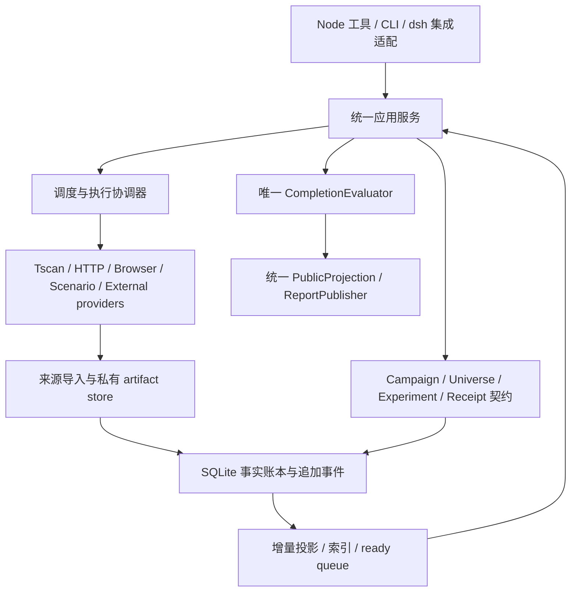

# awa-ddd 优化、升级与渐进重构方案

日期：2026-11-21。审查基线：版本 2.2.0，Git HEAD `3bbee45cf2464f6ff0a5ff4a96e0cfd090ebdea0`。

输入：当前项目，以及 `D:\Backup\Downloads\dsh-session-session-2b66600f-06f2-4b7e-823e-a35a4735c4f8\session.v4.jsonl`。本次完成代码、契约、测试、会话材料和 Tscan MCP 元数据审查；未重新测试历史目标，未执行 Tscan 扫描。本文统计引用审查时的 2.2.0 原始基线。随后工作区已按本路线落地 2.3.0，包括来源账本、TscanPlus 已有结果适配、合法结论凭据、Campaign 隔离、执行预算、可靠 IPC、运行指纹与查询投影；实际实现范围及证据见 [来源账本升级说明](UPGRADE-20261121-SOURCE-LEDGER.md)。2026-11-22 本地 Python 1,708 tests（OK，POSIX FIFO 跳过 1 项）通过，2,000 operations / 20,000 evidence / 500 pages 的 warm 查询均达到 p95 < 500 ms。Node 全量与包的采用条件是冻结后 check/build/fresh install/pack 和最终源码/归档绑定记录通过；真实桌面、WSL、其它 OS、外部服务与下游同步另验。工作区变更尚未提交或向外部发行。

## 1. 建议的方向

采用 **Tscan 辅助发现 + 多来源攻击面账本 + 统一证明与完成判定 + 增量查询与持久调度**，以渐进方式重构为模块化单体。

Node 宿主插件、Python 引擎和 SQLite 可以继续保留。现有范围校验、身份绑定、证据哈希、受控执行、SRC 停止规则和失败关闭的公开输出都有复用价值。V2 已有 Universe、Hypothesis、冻结 Recipe、durable Run、ReviewAcceptanceContract 和多维覆盖声明；应把这些能力与 V1 的证据及发布能力合并为一个核心。

本次问题集中在四条链路：

1. **发现 → 登记**：来源材料已经出现，接口、输入和页面尚未完整进入评估分母。
2. **证据 → 合法结论**：部分 N/A、analyst finding 和 frontier review 缺少能够被接受、复验和失效的对象。
3. **事实 → 查询**：大量读接口在调用时重扫项目和证据，分页不能约束实际计算量。
4. **任务 → 交付**：宿主、V1、V2 和报告各自判断进展与完成，结构性阻塞被转化为重复规划。

信息搜集是第一项产品改进；让收集结果进入可追踪的账本、生成可执行任务、形成可靠结论，是后续重构的主线。

## 2. 审查范围与基线

### 2.1 项目范围

按本次盘点口径，Python 引擎有 76 个文件、26,753 行；Node `src` 有 11 个文件、2,827 行；测试有 106 个文件、31,180 行；既有文档有 33 个文件、3,558 行。审查覆盖入口与工具契约、V1/V2 领域及规划、HTTP/浏览器/外部工具执行、存储、续接、公开输出、报告、打包与测试。

测试数量说明现有项目有较多边界保护。当前需要补的是跨模块的状态可达性、Windows 执行环境、长历史查询成本、campaign 隔离和真正的全流程验收。

Git 跟踪 389 个文件，其中 `work/` 与 `recon-local8081/` 下共有 145 个评估工件。仅检查字段结构就确认至少 8 个已跟踪 session JSON 文件含 Cookie 字段。这证明运行数据与源码的隔离不足；不据此推断凭据当前有效，也不在方案中引用字段值。

### 2.2 审查阶段测试基线

环境：Windows，Python 3.12.0、Node 24.21.0、npm 11.19.0，使用已有依赖。

| 检查 | 审查基线结果 | 解释与处理 |
| --- | --- | --- |
| `npm.cmd run check` | 语法检查通过；221 个测试中 220 pass、1 fail | 失败位于 `tests/host-continuation.test.mjs:289` 的首次真实 bridge timeout 场景 |
| 同一 Node 超时用例定向复测 | 1/1 pass | fixture 将进程冷启动和真实请求纳入 1,000 ms deadline；与 Python 全套并行时失败。按时间假设及负载相关的不稳定测试处理，不能断言产品恢复功能必然失效 |
| Python 全套 unittest | 1,520 tests，17 errors，3 skipped，281.547 秒 | 不能报告全套通过 |
| external/runtime 两组定向复测 | 43 tests，仍有 17 errors | 可稳定复现；不是单纯全套负载造成 |
| 当前发行包 `pack:check` | 审查阶段未运行 | 该行保留原始基线；后续实施验收结果见 [升级说明](UPGRADE-20261121-SOURCE-LEDGER.md) |

Python 错误集中于 Windows 平台识别与 subprocess mock 的相互作用：`runtime._is_wsl()` 先调用 `platform.release()`；Windows 的平台信息回退可能调用 subprocess，恰好命中测试的全局 mock，产生 `AttributeError`、bytes/MagicMock `TypeError`，另有由前序失败引起的 `UnboundLocalError`。修复方向是先识别是否 Linux，再探测 WSL，并给平台探测提供可注入边界。

### 2.3 会话口径

JSONL 有 7,477 行、13,008,727 字节、12 个 turn、1,279 次真实工具调用。主要调用为 PowerShell 424 次、awa_plan 359 次、awa_assess 160 次、awa_execute 98 次、awa_identity 81 次、awa_surface 38 次。119 条 user/message 中仅 15 条来自用户，65 条来自插件自动续接。第二个 turn 持续 217.56 分钟，最终由用户中止。

工具结果中 164 次 `isError:true`，规范化为 96 类错误签名；它们包含参数错误、规则拒绝和重试，不能算作 164 个独立产品缺陷。另有约 297 个预期业务否定结果，不能计为工具异常。turn 9 的 429 是模型配额事件，应与引擎故障分开。

会话跨多个日期；跨度不能作为引擎运行耗时。工具调用、工具错误、宿主取消和模型自身的回合应分别统计。报告/助手叙述中的“9 项 finding（2 machine、6 analyst、1 historical）”未由正式 finalization 或逐项当前证明独立确认；只读磁盘账本累计有 11 个 confirmed finding entity，两者不是同一集合。本次没有重放目标以重新确认漏洞。

会话使用独立 `awa_*` 工具链，`redteam_assessment_*` 实际调用数为 0。仓库同时记载 dsh-purge vendored 核心集成，但不能将本次独立插件的症状直接归因于 dsh-purge 原生调用链。会话未记录可验证的包版本、核心源码路径或 engine commit，不能证明当时加载的源码等于本次 Git HEAD；代码根因映射属于当前源码与症状的关联审查。

## 3. 会话问题与代码根因

### 3.1 已发现材料没有形成完整的评估范围

会话保存的 Spring Actuator `/actuator/mappings` 中有 100 个 dispatcherServlet 映射记录、79 个 Java handler identity，规范化后得到 **73 个唯一 `/api`（HTTP method, path template）候选**，分布在 66 个 path template：GET 24、POST 39、PUT 6、DELETE 4。

最终只读账本有 **16 个 operation、19 个 input**。其中 13 个 `/api` operation 全部能唯一匹配上述来源，因此可确认该 Actuator source 有 **60 个 method/template 候选未登记**；另外 3 个 operation 是非 `/api` 路径。60 表示这个已知来源的登记差集，不能推导为全站全部漏测项或漏洞数。

mappings 材料在首次 surface.register 前 32 分 47 秒已落盘。19 个 input 的来源全为 declared；会话没有执行 surface.import，surface.recon 只调用一次（JSONL 1251→1252）。这说明缺口来自来源导入与任务转化流程，而非单纯尚未获得接口线索。

当前 `engine.evaluate_coverage` 的主要分母来自已登记 operation 及其义务。`security_coverage.ratio=1.0` 只描述内部登记/处置口径，还需要同时显示来源导入、已知未登记、适用性是否被接受和真正测试比例。否则模型会继续完善一个较小的登记子集。

代码定位：`awa_ddd/engine.py:1554`，`awa_ddd/reconnaissance.py:193`，`awa_ddd/planning/campaign.py:27`。

改造：建立 `DiscoverySource → DiscoverySnapshot → NormalizedSurface → UniverseRevision`；来源材料落盘后就登记来源及待解析状态。缺方法、输入、身份或消费者的条目保留为待补定义，进入准备任务。

### 3.2 N/A 缺少合法接受路径

V1 接受 `business_fact + 同 operation 当前证据` 的 N/A 后，completeness 又把所有这类条目加入 `unverified_applicability`，清单提示 reopen。普通响应不能证明整类测试不适用，而现有模型又缺少专门验证不适用理由的 receipt。

会话可确认的末态为 **88 个 applicability review**。最终 project.status 请求在 JSONL 6740 行，结果在 6968 行：review/actionable 均为 107、can_finalize=false、coverage_status=partial、finalization_id=null。不将其它报告快照中的 89 与此末态混用。

代码定位：`awa_ddd/engine.py:1622`，`awa_ddd/completeness.py:266`、`:434`、`:600`。

改造：引入带精确属性、否定谓词、来源版本和证据依赖的 `ApplicabilityReceipt`。只有 accepted 且当前有效的 receipt 才关闭适用性问题；缺证据仍为 unknown/inconclusive/blocked。重新读取、无关任务变化和 checkpoint 不应重开合法决定。

### 3.3 Analyst finding 的通道声明与接受契约不一致

V1 对若干漏洞族声明 `analyst_review` channel，但多数非 XSS 路径不能像机器 decision 一样绑定可关闭的 obligation。finding 可以被登记，随后又成为 `unlinked_analyst`。会话中的旁路测试材料也未自动获得 operation/input/identity/controls 的完整血缘。

代码定位：`awa_ddd/completeness.py:22`、`:308`，`awa_ddd/assessment.py:504`、`:1162`、`:1372`。V2 可复用基础：`awa_ddd/domain/review.py`、`awa_ddd/execution/review_engine.py`。

改造：统一 `ReviewProofReceipt`，逐族定义真实接受条件。机器证明、结构化 reviewed detection、外部来源声明和历史 finding 分开计数。reviewer 类型和身份由可信上下文确定，agent 不能自行声明是独立人工复核者。

### 3.4 查询开销随项目历史增长

`surface.recon` 每页仍在 transaction 内完整 `_build`；aggregate 模式还重新校验、读取和解析最近最多 1,000 个 artifact。`baseline_reused` 表示结果语义相同，不能证明计算被复用。`status/inspect/next/audit/checkpoint` 也多次全量构建覆盖、inventory 或 snapshot。

V2 `Repository.list` 虽有辅助索引，仍先取得全部匹配 ID、hydrate 全部对象、排序，再切片。调用 `limit=10` 并不保证只处理 10 个对象。

代码定位：`awa_ddd/reconnaissance.py:193`、`:368`，`awa_ddd/workflow.py:44`、`:53`、`:148`、`:785`，`awa_ddd/completeness.py:260`、`:766`，`awa_ddd/continuation.py:595`、`:758`，`awa_ddd/domain/repository.py:120`。

改造：SQLite 索引、事件增量投影、artifact 解析缓存、稳定 cursor 和持久 ready queue。普通查询读取投影；消费证明、完成门禁和正式发布仍对必需材料执行强验证。

### 3.5 Frontier 复核绑定了过大的状态

V1 将全部实体、material 和 config 纳入整体 snapshot，frontier 轮次要求绑定当前整体 snapshot。无关状态变化也可能使已有轮次归零，增加收尾困难。

会话 6268 行 checkpoint 曾显示 frontier_rounds=2；6273 行 finalize 仍因未完成 review 失败，最终 6968 行变为 0。已有两轮不能消除仍未合法处置的 review；当前 snapshot 耦合又造成复核失效，两个因素需要分别修复。

代码定位：`awa_ddd/continuation.py:595`、`:657`。

改造：按 discovery、surface、input/consumer、evidence、proof、applicability、page 和 scope 建立依赖根。每份 frontier receipt 只绑定实际依赖。复核轮次必须代表可复验的独立观察；同一 agent 换措辞调用两次不能增加独立性。

### 3.6 防循环逻辑混用了阅读次数与任务可执行性

`loop_guard.observe_next_page` 按相同页面被展示的次数计数，达到阈值后 `mark_frozen` 将返回行改为 blocked；底层执行前提可能没有变化。宿主另有任务去重、失败抑制与续接逻辑，状态解释分散。

代码定位：`awa_ddd/loop_guard.py:75`、`:120`，`awa_ddd/workflow.py:805`，`src/host-continuation.mjs:1`。

改造：展示、领取、执行、失败、冷却、依赖重开分别建模。普通查询不修改执行事实；防重复建议不覆盖 readiness。只有真实 attempt 才计失败，同输入与依赖下持续无进展时，返回结构化 blocker 和解除条件。

### 3.7 V2 升级前必须处理的风险

这些是当前代码审查发现的问题，不作为本次 V1 会话的已证实原因。

| 风险 | 代码依据 | 升级要求 |
| --- | --- | --- |
| Campaign 查询隔离不足 | `planning/coverage.py:23`、`planning/scheduler.py:98` 加载全库 hypotheses/findings/gaps；稳定 hypothesis ID 没有 campaign instance 关系 | 区分可复用 MechanismKey 与 campaign/universe 下的实例；查询强制绑定 campaign |
| 权限上下文在 Universe 转换中丢失 | `domain/universe.py:91` 的 operation record 未保留 ownership、allowed_roles、state_scope；hypothesis 和 scheduler 使用这些字段 | 传递完整安全上下文并做契约一致性测试 |
| Campaign 的来源完整性声明过弱 | `planning/campaign.py:67` 把 scope、registered operation 和 page ledger 统一标为 `complete:false`，route source 未进入 sources | 所有来源进入同一 source matrix，携带 provenance、scope、truncation、digest 和完整性；已知未登记项成为 first-class 状态 |
| target build 不是部署版本 | `planning/campaign.py:80` 由 target+scope 摘要生成 `target_build` | 与 scope identity 分离；无法获取版本时明确 unknown，并制定时效及重验证规则 |
| 写预算声明缺少执行期统一扣减 | `execution/test_runner.py:281` 的多个 control 逐次调用 capture；本地拦截式 fixture 在 `max_writes:1` 下记录到 3 次 write dispatch attempt | 每个 control 声明 effect；dispatch 前原子扣减总预算；与 fixture lease、读回和清理关联 |
| current 状态缺少一致的材料复验 | `planning/coverage.py:60` 依赖 finding 的可变 current 字段 | current 由 receipt、依赖和材料验证派生；完成时强制校验 |
| mutable upsert 与跨进程 CAS 不闭合 | `domain/repository.py:75` 的 mutable add 覆盖实体但不清理旧索引；`store.Project.put` 没有 expected_revision | 实体与索引在同一事务更新、删除旧键；关键命令使用 expected_revision/CAS、lease fencing 和单写者 |
| taxonomy 来源重复 | `domain/hypothesis.py` 定义 12 族，而 `engine.TEST_FAMILIES` 缺少 `access_control` | 建立唯一导入源，供 V1/V2 schema、scheduler、proof profile、Node contracts、report 和测试共同使用 |
| 公共报告发布未统一 | `reporting/matrix.py:136` 直接写多个文件，未复用 V1 分阶段发布契约 | 统一脱敏、自检、manifest 与原子目录发布 |
| V2 未接入宿主续接 | `src/tools.mjs:396` 注册 V2，但 `src/host-continuation.mjs:8` 的绑定/执行集合仍是 V1，查询固定使用 plan.next/audit | campaign/test/review 动作必须触发对应绑定和 CompletionDecision；用真实宿主验证续接 |

V2 还需要复核 mutable upsert 与索引更新的一致性、外部 provider 回执、lease 与跨进程竞争。升级前验收应覆盖这些路径，不能只检查六组工具注册成功。

写预算 fixture 将 capture 替换为本地 artifact writer，没有向目标发包。双 campaign、权限贯通、stale index 和分页成本的独立负载复现尚未完成；这些结论以当前源码路径为依据。

### 3.8 旁路执行与“终版”交付未反映引擎事实

424 次 PowerShell 调用包含直接目标请求、登录、Cookie 处理、上传和外部工具操作；许多未形成 operation、session、resource、artifact 与 coverage 的统一关联。历史会话中 Tscan/Yakit 也出现临时 MCP/脚本调用；本次元数据审查没有重放这些操作。

外部执行应通过 provider 产生统一 receipt。已有旁路材料可导入为带来源的 historical observation/candidate，再按正确身份和控制复核；不能为旧请求补造当时不存在的受控执行记录。

四次 report.build 均请求并返回 draft，finalization_id 全为 null（JSONL 2953→2954、4149→4150、5101→5102、6278→6279）。相应用户可见交付使用了“最终/终版”文案，但引擎从未建立正式 final。需要允许明确的部分交付，并将报告成熟度、覆盖耗尽与已确认发现分开，避免文案替代状态。

### 3.9 宿主并发和超时阶段缺少准确契约

`src/actions.mjs:28` 把 plan.next、http.preflight、assessment.prepare 列为可并发读动作，实际它们写 `.loop_guard` sidecar（`workflow.py:176`、`:805`、`assessment_preparation.py:321`）。当前 sidecar 的 read-modify-write 缺少跨进程协调，可能丢失计数；尚未证明安全证据账本因此损坏。

`src/bridge.mjs:445` 从子进程启动计时，`:491` 提交 stdin 即标 submitted，超时后的保守 uncertain 标记无法区分启动、接受请求和目标派发。实测超时用例在并行负载下尚未发出预期请求即超时。改造需 startup/accepted/dispatch 的可靠握手与 durable receipt；在没有派发证明时不能为了自动重试而把未知效应改成“肯定未发送”。

宿主还在多个项目间串行多次查询（`host-continuation.mjs:452`、`:541`）。应增加总 deadline、公平轮转、查询预算与取消检查。公开 rc.3 SDK fixture 已有测试，但当前环境没有真实桌面 closing→steer→next-step 的完整验收，也没有 V2 实机续接证明。

## 4. Tscan 信息搜集方案

### 4.1 已实测的能力与边界

本次对本机 `http://127.0.0.1:8088/mcp` 仅执行 MCP initialize、initialized notification 和 tools/list：

- TscanPlus **3.5.8**，协议 `2025-03-26`，目录含 **43 个工具**。
- 工具目录 SHA-256：`bec3c772f0bedd3f8d1b19fedd0c470ff44c1dbc0a727bcc89aba8c8435779d6`。
- 现有适配涉及的 `http_request/query_results/project_summary/route_candidates`，本次 schema 静态校验接受。
- 未执行 tools/call，未查询扫描结果或远端项目，未发送目标请求；schema 兼容不等于端到端行为验证。

当前 `url_scan` schema 同时暴露 `poc_check`、`active_finger` 等主动检测字段，复合 `tscan_scan` 还包含端口、口令、目录和 POC 流程。首版适配必须使用只允许已审核发现字段的白名单，不能因为这些字段出现在同一工具中就在一次调用里隐式启用。

仓库 Tscan 文档保留 3.5.4/25 个工具的历史核对；2026-11-21 又在线执行了 3.5.8/43 个 catalog 工具的元数据握手与目录核对，保存结果供离线审查。该次探测没有调用结果 API 或扫描工具，不能证明当前服务仍可达。现有适配提供受控单包、已有结果/route 读取和统一来源账本交接。源码仍限制非默认短 namespace，全长最多 20 字符；服务升级不能成为静默放宽或改绑另一桶的依据。

### 4.2 分两步接入

**第一步：立即可实施的收集与导入。**

1. capability probe 保存 provider/version、协议、工具 schema 摘要和已审核 profile。
2. 绑定本次任务专用 namespace、instance 和 scope；已有结果只读取明确绑定的来源。
3. 用现有 summary/results/routes 接口导入 URL、技术线索、JS 与 route 候选，保存完整性、截断和未取回数量。
4. 同期接入本地已有 mappings、OpenAPI、JS 和 HTTP/浏览器材料。
5. 每次导入返回 created/reused/conflict/out-of-scope/needs-definition 清单及来源回执，立即更新已知分母。

这一阶段即使尚未接入远端主动扫描，也能改善会话中“材料已落盘而账本未扩展”的问题。

首版自动流程只开启这一阶段：只读取明确绑定的已有结果，或处理本地 mappings、OpenAPI、JS、HAR 与浏览器导出；`active_finger`、`poc_check`、口令/凭据验证、端口/目录爆破及复合 `tscan_scan` 均不自动触发。已有结果的读取也要有查询预算和明确 namespace，不能通过“读取结果”间接启动新扫描。

**第二步：受控主动 Web discovery。**

按单独 profile 审核 `url_scan/js_scan/dir_scan`。目前其公开 schema 缺少完整的分页、总请求预算、出站重定向和可靠远端取消保证；实施前需要补上游契约，或提供能实际约束 scanner 出站的网关。单纯过滤返回 URL，不能约束扫描期间发出的范围外请求。

若能力仍不足，使用本地执行器进行有限 URL/JS 获取与目录请求，将材料交给统一解析器；Tscan 继续承担已有结果和能力补充。保留主动 profile 为 unavailable，并返回具体缺失能力。

复合扫描、自动 POC、口令破解、凭据验证和跨域扩展应作为后续独立能力评审。Tscan 返回的告警或推荐动作只提升 hypothesis 的线索与优先级，不直接确认 finding，也不自动调用建议工具。

### 4.3 ScanJob 契约

```text
prepared → dispatch_attempted → results_pending → ingested
                                      ├─ complete
                                      ├─ incomplete
                                      └─ failed / remote_state_unknown
```

状态由可验证的 provider 回执决定。没有 task status 的 provider，不输出假定的 running 或 stopped。

ScanJob 至少冻结：

| 组 | 必需字段 |
| --- | --- |
| 身份与授权 | local_job_id、campaign_id、idempotency_key、AuthorizationSnapshot、scope/exclude |
| provider | endpoint binding、server/version、protocol、tool/schema hash、profile version |
| 范围与预算 | 明确 URL 集、host/path 范围、重定向策略、并发、请求数/字节/时间预算、字典摘要 |
| 远端状态 | namespace、instance/task ID、dispatch receipt、status/cancel 能力、remote_may_continue |
| 结果完整性 | reported_count、returned_count、next_cursor、truncated、results_complete、unretrieved_count |
| 来源材料 | 原始材料私有 ref、sha256、bytes、parser version、来源时间及缺失原因 |

dispatch 前再次核对 scope 和 capability fingerprint。超时或断连保存未知远端状态，禁止自动重放；需支持查询、停止证据或人工 reconciliation。即使扫描只声明 read-only，也记录未知远端运行及请求消耗。

没有分页或完整计数时，显式标 limited/unknown。不能用 `result_limit` 冒充扫描请求预算，不能用空结果证明不存在接口或漏洞。

### 4.4 信息搜集的补充来源

| 来源 | 收集目的 | 转换与局限 |
| --- | --- | --- |
| Tscan URL/JS/目录结果 | 广度与技术线索 | 归一化、scope 校验、去重；告警保持来源声明 |
| Actuator mappings / OpenAPI | 方法、路径、参数、媒体类型、schema、处理器 | 保存版本、缺失与冲突；文档和映射的完备性不等于业务行为已验证 |
| JS AST 与 lazy chunk 清单 | 路由、fetch/axios 请求、参数、页面入口、sink 线索 | 复用 Acorn 解析；记录未取得 chunk、动态计算路径与未知消费者 |
| HAR / 本地 HTTP observation | 真实请求、响应结构、身份和业务流程 | 认证材料私有存储；历史观察带时间及失效信息 |
| 真实浏览器导航 | 页面、功能、交互和 JS 运行时消费者 | 每次 visit 绑定 actor/session；静态 HTML 或导入 JSON 不充当运行时证明 |
| 角色与资源清单 | anonymous/A/B/admin、租户、owner、资源来源 | 角色需服务端核验；只有声明的权限不能视为已经验证 |
| 业务状态与序列 | 创建、读取、修改、支付/兑换等前后状态 | 形成状态图与受控 fixture；未知状态保留准备缺口 |
| 可选源码或技术配置 | consumer、查询/模板/文件/网络处理器 | 白盒与黑盒证据口径分开，冻结 source/build revision |

来源被完整导入，表示该来源清点完成。全站未知攻击面的数量始终可以是 unknown。

### 4.5 来源快照与导入回执

`discover(path, format, base_url)` 必须在一次有界读取中得到并返回来源摘要；所有格式、包括零 operation/零 candidate 的结果，都统一包含：

```json
{
  "source": {
    "path": "resolved-path",
    "sha256": "64-lowercase-hex",
    "format": "format-name",
    "parser_version": 1,
    "byte_count": 123
  }
}
```

`path` 是规范化后的本地真实路径；`sha256` 和 `byte_count` 来自本次已读入内存的原始字节；`format` 必须属于支持清单；`parser_version` 由解析器注册表给出，不能由调用方伪造。规范化上下文如 `base_url` 放入同一 snapshot 信封，而不是事后重新解释路径。

后续 Source/Snapshot/Item 登记只消费这次解析结果，root 导入、差异计算、任务生成和引擎查询不得重新读取源文件。快照身份由来源身份、内容摘要、解析器版本和规范化上下文共同确定；解析缓存键不能使用 mtime 或路径替代内容摘要。

| 情况 | 契约结果 |
| --- | --- |
| 同一路径、同一字节、同一 parser/base_url 重复导入 | 复用同一 snapshot 和 source item ID；不重复登记 operation/candidate，重复项进入 `reused` |
| 对已保存历史快照再次 apply | 仅传 `snapshot_id`，不要求 path/format/base_url，也不重新读源文件；snapshot、item、digest 与 parser version 保持原值 |
| 同一路径已有快照，源文件后来被删除 | 已有快照按其捕获版本继续可审计；refresh 明确返回 source unavailable，不伪造空快照 |
| 合法空结果 | 仍保存 source 摘要、格式、字节数、parser version 和 limitations；状态不得提升为全站 complete |
| 同字节、parser version 变化 | 创建新 snapshot，以新旧版本差异展示 added/removed/changed；不能覆盖旧 provenance |
| 同字节、同 parser version 但输出非线性变化 | 返回 `source_snapshot_conflict`，要求升级 parser version，禁止静默改写 |
| 文件超过大小或编码限制 | 返回结构化 import error；不创建“已完整清点”的空 snapshot |

后续 P1a 实施已经打通 Source/Snapshot/Item/ingest receipt、所有本地格式的 source envelope、Actuator dispatcher、preview/精确 snapshot 分批 apply、`surface.sources` 及主状态登记差集；Python publication 与 Node action/tool surface 也已同步。每次 apply 的实际写入受 offset/limit 约束，展示截断仅通过只读 sources 恢复。已保存来源快照的比较、查询投影、只读 provider ingest 与验证边界见 [实施说明](UPGRADE-20261121-SOURCE-LEDGER.md)。

Actuator 的 mapping、handler identity、route、path template、method 与 unresolved 数保存在 snapshot 的额外 inventory 元数据中；operation/candidate 的当前登记差集实时按账本计算。malformed context/dispatcher/group 等未知容器计入 unresolved，即使没有任何 item 也保留来源缺口。新增格式必须同时接通 parser、public schemas、宿主契约和失败用例，不能仅加入枚举。

### 4.6 归一化与输入建模

攻击面身份包含 origin、method、protocol、path template、operation variant 和媒体类型。参数身份包含 location、selector、schema branch、真实请求绑定及 consumer。GraphQL operation、multipart 字段、WebSocket message 或不同 Content-Type 不应只按路径合并。

保存 alias、动态 path、资源关系和每一条 provenance；GET/POST 同路径、同 endpoint 不同输入分别生成义务。冲突进入待核对队列，不能静默覆盖方法、身份或 query 绑定。缺消费者保持 needs_consumer；普通成功响应不能用来排除 SQL/XSS/SSRF 等整族。

OpenAPI 与 Actuator 中的简单模板仅当每个占位符占据完整路径段、变量名匹配 `[A-Za-z_][A-Za-z0-9_-]*` 且全路径不重复时，才登记为 `path_template=true`、`native_input_requires_binding=true`、`requestable=false` 的 operation，并生成对应 location=`path` 的精确必填 input。该动作零发包，预览保留 pending import，apply 后状态为 `needs_binding`；真实执行仍由 engine preflight 拒绝未绑定 URL。wildcard、`**`、`{id:regex}`、编码占位、非完整路径段、重复或非法变量名、未知 method 继续进入 candidate，不放宽现有 candidate 闭环。

## 5. 目标核心与领域契约



应用服务持有业务规则；V1/V2 facade 只校验、映射参数与公开返回。provider 只报告可验证的执行事实，不自行授予完成或 confirmed 权限。

### 5.1 核心对象

| 对象 | 责任与关键绑定 |
| --- | --- |
| AuthorizationSnapshot | 目标、范围、exclude、授权来源、有效期、请求与效应预算；独立于模型说明文字 |
| DiscoverySource/Snapshot | 真实路径、内容摘要、字节数、格式、parser/provider version、规范化上下文、覆盖区域、完备性、缺失；空结果同样保留来源信封 |
| UniverseRevision | 规范化 route/page/operation/input/consumer 与未知项；保留所有来源 |
| MechanismKey + HypothesisInstance | 可复用机制身份；campaign+universe 下的独立任务、attempt 和结论 |
| SurfaceRevision | method/protocol/input/auth/roles/ownership/state_scope 的签名及版本 |
| ExperimentSpec | 冻结 provider、控制组、identity、fixture、oracle、预算；运行时只允许声明的变量 |
| Run/DispatchReceipt | prepare、claim、dispatch、响应、unknown effect、读回与清理的事实 |
| EvidenceRef | 原始字节摘要、请求指纹、operation/input、actor/session、来源及时间 |
| ProofReceipt / ReviewProofReceipt | 精确属性、因果机制、控制、proof_scope、not_proof、接受者及依赖 |
| ApplicabilityReceipt | 精确前置条件不成立的谓词、验证器、来源、版本与接受状态 |
| FrontierReceipt | 本轮复核主题、材料、实际依赖和剩余未知项 |
| CompletionDecision | 当前依赖、各维状态、未完成原因和本次可授予的交付权限 |

实体事实与 receipt 追加保存。队列、current、coverage 和公开页是派生状态，可以重建。可变 aggregate 使用 expected_revision/CAS；不使用一个 status 混合描述证据有效性、执行就绪、审阅结果和交付状态。

同一 campaign 中，无关来源新增不应清空原 hypothesis 的 attempt 与证明。用 versioned UniverseMembership 保存实例与各次 Universe 的关系；机制与相关绑定不变时保留实例历史，依赖变化才过期或生成新实例。

### 5.2 适用性与证明接受

Applicability 生命周期为 `unknown → proposed → accepted/rejected/expired`。receipt 绑定具体 security_property 与 input branch，验证“该属性的前置条件不成立”。例如不存在对应 consumer，需要冻结版本的源代码/配置与来源支持；黑盒没有观察到 consumer 时保留未知。公开接口仍可能包含业务安全属性，不能整体免除 access control 或 business logic。

ReviewProofReceipt 复用 V2 的 ReviewAcceptanceContract，包含 operation/input、normal/attack/negative 控制、观察、consumer、身份/资源、因果解释、proof_scope、reviewer 和 digest。各族的观察要求独立定义：

- 表达式求值需要值与字面量对照，并排除反射；不升级成代码执行。
- 命令类需要有界副作用或独立观察；时间差不能作为唯一证据。
- 反序列化需要明确类型机制与有界观察；解析器识别不证明危险类型实例化。
- 上传需要真实存储契约与内容读回；响应给出路径不证明路径逃逸。
- 权限需要同资源、不同身份/角色的矩阵与归属证据。
- 业务状态需要前置状态、受控变更、读回及清理；未知写入保留 unresolved。

先交付有真实接受路径的族，能力目录准确报告 supported/partial/unavailable。其余族保留结构化 blocked，待补 profile 后扩展。

### 5.3 依赖与失效

依赖根至少包括 scope、discovery、surface、consumer、identity/session generation、resource/fixture revision、evidence material、oracle/profile、proof、applicability 与 page。

新 actor 不应让无关公开接口 proof 失效；已有 actor 的 session 更新应使依赖旧 session 的证明过期。新页面应重开相应 discovery/page frontier；无关运行的审计时间不重开所有族。

target build 与 scope epoch 分开。白盒可使用部署标识、源码提交或发布摘要；黑盒无法证明 build 时返回 unknown，设置观察时效，执行/交付前重新验证相关表面和材料，保留局限。

artifact 由引擎在导入时复制到内容寻址的私有 store 并校验。外部文件篡改可能没有 domain event，因此 completion、proof 消费和正式报告不能仅信事件缓存或 mtime：必须重验所需字节。后台 scrub 发现异常时追加 corruption/invalidation 事件并隔离对应材料。

### 5.4 现有模块的演进边界

| 当前实现 | 统一后的责任 | 迁移方式 |
| --- | --- | --- |
| store / domain.repository | UnitOfWork、CAS、campaign-scoped Repository、ProjectionStore | 先加索引与事务 API，旧调用薄封装兼容 |
| discovery / reconnaissance / recon_parsing / importers / route_parser | 多来源 discovery、规范化、provenance 和 completeness | 复用解析器；查询与导入分开，所有来源走同一 ingest |
| engine / workflow / v2api / planning.campaign | application commands/queries 与 canonical model | 逐动作迁移；facade 保留参数与返回兼容 |
| assessment / finding_binding / oracle_profiles / review_engine | Evidence/Proof/Review/Applicability 的验证服务 | 先建立接受契约，再迁移各族与门禁 |
| completeness / continuation / loop_guard / scheduler | CompletionEvaluator、FrontierReceipt 和持久调度 | 影子比较，减少重复状态所有者 |
| transport / browser / scenario / external / tscanplus | 受控 providers 与执行协调器 | 保留现有边界，统一 receipt/预算/取消与效应 |
| publication / reporting_legacy / reporting.matrix | PublicProjection 和 ReportPublisher | 复用 V1 发布保护，让 V2/错误/宿主共用入口 |

模块抽取以这些职责为边界。旧接口作为 facade 或 shim 保留；同一验证规则只能有一个实现。

## 6. 覆盖、调度与交付

### 6.1 对用户展示的维度

| 维度 | 应回答的问题 |
| --- | --- |
| 来源清点 | 已声明来源有多少已取得、已解析、截断、缺失？ |
| 已知表面 | 规范化后的已知 route/operation 有多少登记或待定义？ |
| 输入与消费者 | 精确输入、分支、consumer 和身份资源关系是否可用于实验？ |
| 假设执行 | applicable hypothesis 有多少实际测试、受阻、结论不明？ |
| 证明 | 有多少当前 machine proof、accepted reviewed proof、历史或外部声明？ |
| 适用性 | 有多少 accepted N/A、unknown 和 expired？ |
| 交付 | 可完成声明范围、可发布部分报告、仍需材料或 reconciliation？ |

每个 ratio 附分母定义、来源、时点、snapshot root 和未知项。旧 ratio 保留兼容字段，主显示区分“已登记义务处置率”“实际测试比例”“当前证明比例”。accepted N/A 只进入适用性/处置维度，不能当作已经测试。报告和宿主摘要同时展示已知未登记与来源限制。

首页状态固定给出 `known_not_registered_total`、`needs_binding_total`、`pending_import_total`、`unresolved_total` 和 `historical_pending_total`，再给已登记子集的处置率。来源导入成功只表示来源已纳入账本；零未登记也只在声明来源和快照范围内成立。

建议做一个评估工作台：来源导入进度、待定义接口、可执行任务、blocked 解除条件、证明分层和交付状态共用同一读模型。详情页显示来源到结论的证据链；普通产品流程不暴露内部 schema/hash 等实现细节。

### 6.2 持久调度

持久队列按 campaign、family、operation、readiness、priority 和依赖索引读取。调度公平性兼顾未测比例、业务重要性、身份/写效应、成本和 aging。Tscan/JS 线索可以提高优先级，但来源提示不能改变可执行性或证明权限。

假设生成从精确输入、consumer、资源/角色边界和业务属性出发，避免给所有接口机械生成全部漏洞族再批量 N/A。未知 consumer 生成准备任务；未生成或不支持的族仍显示 not_assessed/blocked，不因队列为空就宣称该族不适用。先补已知未登记表面，再公平分配已登记任务，避免长期只完善原有小子集。

同一 mechanism 不因 statement 改写重复生成任务。attempt 按真实 dispatch/评估结果计数；未知效应、清理失败与准备失败分别记录。领取任务使用 lease token、expected_revision 和 fencing，跨进程只能有一个有效执行者。

每次 next 返回少量完整任务与差量：新增来源、已关闭项、已重开项、真正缺失的前提。相同任务与依赖下持续无进展时，保存 blocker，不再通过读取次数反复切换 ready/blocked。依赖补齐、明确新证据或冷却到期才重新入队。

### 6.3 唯一完成判定

CompletionEvaluator 同时服务 V1 finalize、V2 finish、宿主续接和报告。至少区分：

- `complete_for_declared_scope`：声明来源与范围的必需项已合法处置，材料当前，无未知运行效应，frontier 有效。
- `partial_available`：可生成当前发现与限制报告，未完成项仍可见。
- `partial_accepted`：已有明确交付接受记录；不能赋予 exhausted 权限。
- `blocked`：缺材料、环境能力或 reconciliation；列出解除条件。

unknown/blocked/inconclusive 不进入“已验证”的分子。来源 complete 也不授予未知全站完备性。SRC 模式继续遵循直接证据后的停止规则，剩余范围作为未测/受阻交付，不为刷满覆盖率扩大利用。

普通读与报告草稿可以随时执行；最终 authority 由 CompletionDecision 明确授予。用户停止、暂停或宿主取消优先。结构性阻塞给出一次可理解的失败说明和所需输入，不能强迫模型无限调用规划接口。

## 7. 性能与执行一致性

### 7.1 SQLite 增量投影

先改善访问模式，再根据实测决定是否需要常驻 worker。初期保留现有 JSON/CLI bridge 和单项目 SQLite。

新增或演进：

```text
domain_event(seq, campaign_id, type, entity_id, revision, payload_ref)
projection_cursor(projector, last_seq, schema_version)
artifact_parse_cache(sha256, parser_version, facts_ref)
surface_index(campaign_id, universe_id, method, origin, path_key, ...)
receipt_dependency(receipt_id, dependency_kind, dependency_id, revision)
hypothesis_queue(campaign_id, status, readiness, priority, lease, ...)
coverage_projection(campaign_id, dimension, denominator_kind, counts, roots)
```

写事实的事务同时追加事件；projector 幂等消费。同步读可 flush 必需投影到 event seq；最终门禁在 flush 后执行独立材料校验。投影 schema 可升级、重建并与旧 evaluator 影子比较。

SQL 使用索引、稳定排序和 `limit+1`。cursor 绑定 campaign、查询条件和 projection revision，避免新条目导致重复/遗漏。只 hydrate 当前页；count 来自独立聚合或投影，不为计算 total 加载所有 JSON。

当前实现已将来源分页与 recon aggregate 分开，并按 generation 复用普通查询投影。强重建、compare、checkpoint、证明消费、finalization 和正式报告仍运行全局 evaluator；普通查询仍核对全部保留材料的当前 metadata。进一步拆出只处理变化材料的 refresh 和按依赖重算的 checkpoint，是后续性能方向，需要另做失效正确性验证，不能作为本版已实现能力。

若剩余延迟主要来自 Python 冷启动，再引入每工作区常驻的受控 stdio/本地 IPC worker。保留 CLI 回退、请求 schema、cancel/deadline、进程身份和发布边界；执行中的未知请求继续用 durable receipt 处理。

### 7.2 执行协调器

每个 ExperimentSpec 经过 `prepare → claim → dispatch → response/material persistence → evaluate → readback/cleanup → publish`。事务要短，网络请求不能占用长写事务。

dispatch 前原子检查 campaign/scope/session/fixture revision、lease token、预算和 idempotency，并持久化 dispatch attempt。响应、artifact、step 和 run 关系在可定义的本地事务中提交；崩溃留下可恢复状态。

本地数据库与远端 HTTP 不能原子提交。本地 idempotency 保证不自动重放，不能凭此宣称目标 exactly-once。失联后保留 `effect_unknown/remote_state_unknown`，只进行受控状态读回与 reconciliation。

写预算按 control 的实际 effect 扣减。三个必须写入的 control 不能在 `max_writes:1` 的 recipe 下执行；应重设计为一次写入与只读对照，或分别使用独立 fixture/experiment，并让总授权预算真实反映总效应。cleanup 也有独立保留预算与总请求核算，不能成为不计数的写路径。

可变实体统一 expected_revision/CAS；mutable upsert 在同一事务更新/移除旧索引。fixture 先领取，再派发；租约过期不能让第二 worker 忽略第一请求的未知效应。

## 8. 宿主、发布与工程治理

### 8.1 共用宿主契约

Python action registry 是动作/字段/能力的唯一来源，生成或校验 Node 工具 schema、help、next task 和续接所需字段。契约记录 schema version、engine version、capabilities 和根摘要。

每个动作有准确 input schema、effects 与并发条件，减少对长描述和 additionalProperties:true 的依赖。参数错误返回字段路径、缺失项和已校验的最小模板；模型可按需取 help，无需反复猜 action/input 层级。并发安全由实现的事务与副作用确定，不能只由 READ_ACTIONS 名单推导。

来源链路必须同时出现在 Python publication schema、Node 工具枚举、help 和宿主能力探测中。`surface.import` 是写动作，明确支持 preview/apply、`snapshot_id` 与分页结果；`surface.sources` 是只读分页查询，支持 source/snapshot/status 绑定。两者返回 `source_inventory`、counts、results、完整性/截断、`requests_sent` 和 `next_action`，边界层不得因旧 schema 白名单把这些字段丢掉。

宿主只根据 CompletionDecision 与结构化 delta 决定继续、等待或停止，不自行拼另一套完成 boolean。V1/V2 均进入相同契约。取消后的工具返回 durable run/ref 与未知效应，续接只安排合法离线检查或 reconciliation。

V2 的 campaign.start/next、test.run、review 等动作进入绑定和活动集合，续接调用 campaign 对应查询。多项目续接有总 deadline、每项目查询预算与公平轮转；不遍历所有历史项目后才响应 turn-stopping。

bridge 增加 startup、command accepted、dispatch attempt、response persisted 的可靠阶段回执。ENGINE_START_TIMEOUT 与已派发后的未知效果分开，但缺少可信阶段信息时保持保守 unknown。阶段协议应先于自动恢复策略上线，防止冷启动延迟被引导去检查不存在的 run，也防止真正发出的请求被自动重试。

每次会话记录 package/core version、loaded source fingerprint、模式、runtime backend 与 capability fingerprint，使后续日志能够关联到实际部署代码。

### 8.2 统一公开输出

统一 PublicProjection 和 ReportPublisher：action handler 返回内部对象，边界层生成公开 schema。项目 secret index 有 revision 和失效规则；正常调用复用当前 index，新增凭据及时扩展识别。

公开 query 有响应预算与 cursor。超限返回材料 ref，不截断 proof 的必需字段。默认给模型简短状态和下一步，详情按需读取。私有 payload、请求头和 session 内容留在 artifact store。

报告在 staging 生成，检查最终字节脱敏、所有文件 digest、来源与 proof 分层、CompletionDecision 与当前依赖；成功后原子发布新目录。失败返回 publication 状态，已完成的请求事实不回滚，也不重放。V1/V2、错误、外部结果和宿主摘要采用同一公开入口。

报告应同时包含已确认问题、reviewed 结论、外部候选、历史材料、未测/受阻项、来源局限与复验要求。部分报告可以完整交付这些事实，不能显示全站已评估。

### 8.3 仓库与发行

运行项目、recon、session、报告和测试靶场工件迁出源码树的默认版本控制范围；脱敏 fixture 单独维护。先做 inventory 与迁移清单，再处理已跟踪工件。删除历史、改写 Git history 或清理原始评估数据属于单独实施事项，本次不执行。

增加已跟踪文件的敏感结构/内容扫描和生成目录检查；`.gitignore` 只影响未来新增，不能解决已跟踪数据。若核实有真实有效凭据外泄，按实际所有者处理撤销/轮换，而不是仅删除文本。

保留 peer SDK 由宿主提供的单实例规则、npm/wheel allowlist 与提取后 smoke。发布 CI 验证 Python 子包、Node 入口、工具注册、help、只读 fixture 和报告流程，检查源码版本与集成清单相同。

当前 npm 文件清单排除 `awa_ddd/tests_*.py`；Python 发布验证脚本检查 wheel/sdist 不含私有测试模块。2.3.0 的 wheel/sdist、独立 venv fresh install、CLI/模块入口、75 动作目录（含 `report.artifact`）、单发行物约束和 npm 提取 smoke 都须在本次冻结源码上验证。`final-validation.json` 的 passed 和当前源码/归档 SHA-256 绑定是发行采用条件；历史 2.2.0 或更早产物不能作为当前验收证据。

peer SDK 的宽版本范围不代替兼容验证。对最低支持版本、当前 rc.3 与后续明确支持版本分别验证 schema、并发、取消及 turn-stopping。真实 Windows DSH 安装/重载后验证 V1/V2 的 closing→steer→next-step，记录实际加载源码指纹。

独立 awa-ddd 与 dsh-purge vendored 核心采用可追踪版本 manifest 和同一 conformance suite。此仓库的改动不会自动更新另一发行包；下游同步是发布清单中的独立门槛。交换只传版本化候选与证据元数据，不共享 SQLite schema，不信任外部 confirmed 声明。

### 8.4 测试与可观测性

CI 分平台、分资源运行：Windows native、Linux，以及声明支持的 WSL 后端；Python 最低支持版本与主要验证版本，Node 最低支持版本与实际宿主版本。隔离全局 platform/subprocess mock，超时 fixture 先确认服务/请求就绪再测试超时与取消。

测试重点从“每个分支返回某字段”补充为“完整状态能否到达”：收集、登记、身份、fixture、执行、证明、N/A、frontier、完成和报告。真实 Tscan 测试使用独立 namespace 和自建 fixture；常规 CI 用 mock MCP，不读取共享扫描数据库。

动作级记录 trace/action/campaign/run ID、db rows、parse/verify 数、投影延迟、bytes_out、冷启动、cache hit、unknown effect 和可执行变化。性能指标放诊断/trace，不污染产品主流程。

## 9. 实施路线与交付物

下表保留原始分阶段审查与交付口径，并补充当前验收状态。工作区 2.3.0 源码包含 P0–P5 的主要代码路径；Node 与 Python 全量已通过，最终规模门槛已实测。发行物仍需在文档冻结后完成构建、fresh install、pack 和最终字节绑定；因此“代码路径已落地”“本地回归通过”和“发行物可采用”在这里是不同状态。

首批用户可见价值现已按以下顺序交付：

1. 所有本地发现格式返回 sources 快照契约，材料导入后立即显示登记差集；主输出先显示已知未登记数。
2. 合法 N/A 与 reviewed proof 有独立 receipt、接受、依赖和失效路径，不再用自由文字或整族普通响应闭环。
3. 普通页面、status、next、audit 在投影有效时只水合当前 SQL 窗口；方法内 operation ID 另有独立分页。缓存失效与 checkpoint 会执行全局强评估，实际 metadata、解码及哈希成本单独记录。
4. 写预算、dispatch receipt、unknown effect、lease 和 reconciliation 先成组落地；未知远端/目标效应不得自动重放。

这四项应共享同一 Source/Snapshot、Receipt、Completion 和查询契约，避免先交付四套临时接口。

| 阶段 | 工作区状态与交付物 | 出口验证 |
| --- | --- | --- |
| P0 本地回归通过 | Windows runtime baseline、并发分类、runtime/deployed fingerprint、nonce/hash 绑定的 startup/accepted/dispatch IPC、after-dispatch timeout fixture | Python 全量通过；Node 全量采用冻结后最终记录，真实宿主版本另验 |
| P1a 本地回归通过 | DiscoverySource/Snapshot/Item/Ingest、七种本地来源、preview/apply、known-registered difference、surface.sources | 全量与旧项目兼容 fixture 通过；原 mappings 字节缺失，parser 使用合成 fixture |
| P1b 只读适配已落地；主动能力 unavailable | Tscan 已有结果/route 的账本与 receipt 代码、目录/schema 漂移门禁、clue-only 候选 | 主动 Web discovery、POC、爆破、复合扫描和发现 URL 访问不可达；本轮没有最终在线 Tscan 验收 |
| P2 本地回归通过 | 单一 taxonomy、campaign/universe 归属、权限上下文、AR/RPR、CompletionEvaluator 与 V2 acceptance | 全量通过；真实多 campaign 业务状态另验 |
| P3 本地回归及规模门槛通过 | SQL 索引/分页、stable cursor、generation projection、ready queue、来源局部投影、inspect/rebuild/compare、migration/rollback | 2,000/20,000/500、25 次 warm 样本通过；全部材料 metadata 仍核对，强重建单次 32.0 s，仍全局强评估 |
| P4 本地故障 fixture 通过 | UnitOfWork、CAS/lease/fence、原子请求/写预算、DSP/REC、unknown-effect reconciliation、Browser/sqlmap 双层 dispatch | 全量通过；真实服务故障注入与主动 Tscan 出站/取消另验 |
| P5 本地回归通过；发行以最终记录为准 | V1/V2 宿主 binding、AR/RPR/FRC/CA、partial OFFLINE 串行路径、原子报告/分页、SMIG 迁移/只读回滚 | build/fresh/pack/最终字节绑定均须 passed；partial receipt 无停止/completion/final 权限，真实 desktop closing→steer 另验 |
| P6 本地自动化已执行，CI 定义已准备 | Python 全量、规模 benchmark、故障 fixture、Windows/Linux CI 与发行验证工具 | 本机未运行 CI 矩阵、真实桌面、WSL、其它 OS、外部服务或下游同步 |

关键依赖：P0 → P1a；P1a → P1b/P2；P2 → P3/P4；P3/P4 → P5；P5 → P6。主动 Tscan profile 可独立延期，已有结果和本地多来源导入可以先交付。

第一批 PR 建议按以下粒度拆分：

1. Windows 平台探测与超时测试修复；记录完整 baseline。
2. source snapshot envelope 与 mappings/OpenAPI/JS/HAR 统一 ingest；主输出显示已知未登记。
3. ApplicabilityReceipt + ReviewProofReceipt + CompletionEvaluator 的最小合法接受路径。
4. SQL cursor、增量投影和 ready queue，使分页和 status 不再触发全量构建。
5. coordinator、预算、lease、unknown effect 与 fixture reconciliation。
6. taxonomy、安全上下文与 campaign-scoped instance/repository。
7. Tscan 已有结果读取/导入，再单独审核主动 Web discovery profile 与 provider conformance。
8. 宿主、发布、迁移、包验证与下游核心同步。

每个 PR 带独立 fixture、契约变化、兼容说明和退出条件。facade 中不新增第二份证明或完成规则。

## 10. 数据迁移与回滚

1. 备份项目数据库与 artifact manifest，记录 schema/core 版本和摘要；先 dry-run。
2. 新增 canonical 表/索引和影子读模型，保留旧实体和原始材料。
3. 旧 operation/input/page 转 SurfaceRevision/Universe，补真实 provenance；未知字段保持 unknown。
4. 旧 evidence 保留 ID 与字节关联；decision 保留 legacy evaluation，不能伪造 TestRun。
5. 旧 N/A 与自由文字 finding 进入 legacy_unverified；可由真实材料执行新验证器生成 receipt，缺条件则保留待核对。
6. 旧 frontier 保留历史；不补造当时不存在的依赖根或独立复核。升级后生成新的合法 receipt。
7. 旧 campaign 归属无法确定的实体进入 quarantine，不自动归给最新 campaign。
8. 影子比较 coverage、remaining、proof、完成判定与公开输出；列出每项差异及原因。
9. 按项目切换 canonical 写入，旧 facade 映射同一核心。影子处理只派生数据，不重复执行目标请求。
10. 回滚先切只读旧视图/兼容模式。新 canonical 执行产生的事实不能丢失；没有兼容投影时不恢复旧写路径。保留全部 receipt，禁止回滚触发重放。

同一事实只有一个写入所有者。采用读取影子验证和版本切换，避免两套核心同时执行或自行冲突修复。

工作区已用 `project.migrate`、`project.rollback` 和 `project.projection` 实现上述原则：`dry_run` 在稳定只读快照上零写入，`apply` 生成 `SMIG-*`、内容寻址私有备份与 legacy/quarantine 标注，rollback 进入保留新事实的 `legacy_read_only` 视图。普通读使用 advisory projection，证明消费、checkpoint、finalization 与正式报告继续强校验原始材料。

## 11. 验收场景与建议指标

以下是建议验收门槛，并作为当前回归与部署验收的统一口径。已落地范围、定向测试及最终全套结果见 [来源账本升级说明](UPGRADE-20261121-SOURCE-LEDGER.md#验证状态)；未执行真实目标、真实桌面宿主或外部扫描的项目仍按未验证处理。

| 场景 | 必须成立的结果 |
| --- | --- |
| 合成 fixture：73 个规范 operation，登记 16 个 | 明确显示 57 个已知未登记；registered 子集完成度不能作为整体 headline。此数值夹具不等同于本次会话映射项 |
| 同来源重复导入，来源方法变更 | 重复复用 ID 与 provenance；方法/绑定变化产生冲突或新 revision |
| 历史 snapshot 的离线 apply | 不访问已删除/变化的源文件；按保存的 item 和 provenance 幂等处置，snapshot 递增关系保持 |
| 空结果、源文件删除、parser version 变化 | 空结果仍带 source 摘要且不授予 complete；已捕获快照保持可审计，refresh 明确 unavailable；新版本生成可比较 snapshot，不允许覆盖旧记录 |
| OpenAPI 简单/复杂 path template | 合法完整单段变量登记为 `needs_binding` 且零发包；wildcard、正则、编码、重复变量和未知 method 只进入 candidate，执行前仍拒绝未绑定 URL |
| Tscan result_limit 截断、断连、默认桶、schema 改变 | 结果 limited/unknown；默认桶/清空拒绝；未知 dispatch 不重放；schema 变动需 profile 审核 |
| Tscan 范围外重定向与发现 URL | 扫描出站约束阻止访问；返回过滤本身不被视为满足此项 |
| 合法 N/A + 无关 checkpoint | accepted receipt 持续有效并闭环；相关 source/build/predicate 变化才过期 |
| 普通响应 + “不适用”自由文字 | 保留 unknown/inconclusive，不能批量免除整个漏洞族 |
| 支持的 reviewed proof family | 存在真实 positive/negative/reflection/control fixture，能绑定义务；篡改任一必需材料后失效 |
| 两 campaign 同 mechanism | attempt、lease、finding、gap 和 completion 互不污染 |
| 权限输入转换 | ownership/roles/tenant/state_scope 在 Universe/recipe/proof 中完整保留 |
| Frontier 后新增无关 run / 相关页面 | 前者不清零；后者只重开对应 receipt 和任务 |
| 相同任务仅被读取多次 | 不改变事实 readiness；真实失败才能冷却或产生 blocker |
| 并发 next/preflight/prepare | 调度状态不丢更新；存在 sidecar 写的旧路径不声明纯读并发 |
| 多 control + max_writes:1 | 第二次写在 dispatch 前拒绝；cleanup 与总请求预算可核对 |
| timeout/进程崩溃/lease 过期 | receipt 可恢复；未知效应阻止自动重试；fencing 拒绝旧 worker |
| 冷启动超时 / 派发后超时 | 可信握手证明尚未派发时返回 startup timeout；派发后仍保护未知效应，不能统一成不存在的 run 检查 |
| 外部 artifact 被改且没有 event | 完成/证明消费的强字节校验发现失效；投影缓存不能授予旧 authority |
| 报告自检失败或中途崩溃 | 不出现部分正式目录/manifest；内部 run 事实仍存在 |
| V1/V2/host 同事实输入 | 当前证明、remaining、partial/complete 和停止判定一致 |
| 真实宿主 V2 未完成 turn + 多项目 | campaign/test/review 触发有效绑定与一次合法 steer；总 deadline 与取消有效，无重复发包 |
| npm/wheel/sdist fresh install | 包不含敏感运行工件或内部测试模块；工具目录、版本与源码指纹一致 |

性能夹具：2,000 operations、20,000 evidence、500 pages。普通 warm 查询每项 25 次，p95 < 500 ms、常规返回 ≤ 32 KiB、compact ≤ 16 KiB 的门槛已通过；Windows/Python 3.12/AMD64/16 个逻辑 CPU 的实际 p95、返回大小和冷热条件见 [规模结果](UPGRADE-20261121-SOURCE-LEDGER.md#验证状态)。warm 页 hydrate 当前 SQL 窗口，并按 generation 缓存 locator 后用批量目录枚举读取全部保留材料的当前 metadata；统计不跨查询缓存。强 rebuild/compare、证明消费、completion 和正式报告仍运行全局强评估；强投影重建单次 32.0 s，不把单样本当稳定 p95。

当前 checkpoint 与强重建仍逐次校验所需材料字节并运行全局评估；material_bytes_hashed 与 artifact_bytes_hashed 记录实际读取成本，不跨调用缓存真实性。按新增/变化材料局部重算仍是后续方向。调度/状态调用成本用同一合成离线夹具比较，不把整个多日会话的调用数直接当作可复现性能基线。

召回验收使用固定版本、相同账号/资源/业务状态的本地靶场，区分 blind、hint-assisted 和 imported 轨。报告 precision、已知案例 detection、machine proof、reviewed、未测与失败成本；样本有限时不给出全站召回承诺。

## 12. 实施选择

当前实现继续使用 SQLite、Node 宿主插件和 Python 引擎。新增组件围绕同一 Source/Snapshot、Receipt、Completion 和 execution coordinator 契约组合；旧入口保留兼容，不再各自定义完成、证明或停止规则。

“发现材料能入账、合法结论能闭环、查询成本有界、未知效应可恢复”四项的实现已进入 2.3.0 并通过本地全量回归和规模门槛。默认模型仍由宿主配置选择；V2 包含 campaign 隔离、权限上下文、执行预算、共享完成门禁和原子报告。主动 Tscan discovery 仍 unavailable，因为它缺少可靠出站范围、重定向、远端取消/状态和 cursor 契约。warm 页仍核对全部保留材料的批量 metadata，强重建仍是全局计算。

工作区 Node/Python 源码版本为 2.3.0，Python 1,708 tests（OK，平台跳过 1 项）及规模记录均有源码/日志字节绑定。Node 全量、wheel/sdist、npm 包和本地安装包必须绑定冻结后的 check/build/fresh/pack 与 `final-validation.json` passed 记录；采用规则见升级说明。变更未提交、推送、部署或同步到 `dsh-purge`。这些本地结果不代表用户桌面 profile、真实 WSL/其它 OS 或下游发行已完成。

Tscan 的收益通过已知攻击面扩展、来源完整性和任务转化率衡量。本地证明的收益通过有效 receipt、失效正确性和可复验交付衡量。这两条指标共同决定升级是否真正改善了评估流程。

## 附录：证据导航与口径

| 证据 | 位置或核对点 | 结论范围 |
| --- | --- | --- |
| 当前源码身份 | 审查基线 Git HEAD `3bbee45c`；[package.json](../package.json)、[pyproject.toml](../pyproject.toml)；升级说明中的源码 manifest | 审查时源码为 2.2.0，当前为 2.3.0 本地验收源码；包须满足最终字节绑定，也不证明历史宿主加载版本 |
| 会话统计与调用链 | 原 session.v4.jsonl；7,477 行；redteam 工具实际调用为 0 | 仅独立 awa 链的会话事实 |
| Actuator source | 会话关联 mappings.json，100 mappings/79 handlers/73 API method-template pairs | 已知来源；与账本唯一匹配 13，差集 60；未知全站分母不授予 |
| Recon 与登记 | JSONL 1251→1252、1397；只读账本 16 operations/19 declared inputs | 3 个 operation 的逐条 register 回连不完整，账本存在可确认 |
| N/A 末态 | JSONL 6740 请求→6968 结果；另有 5082、6263、6268 佐证 | 88 applicability review；不与其它快照的 89 混用 |
| Frontier 与 finalize | JSONL 6268、6273、6968 | 2 轮后仍被 review 阻断，最后 0 轮、partial、无 finalization |
| Draft 报告 | JSONL 2953→2954、4149→4150、5101→5102、6278→6279 | 文案可称终版，但引擎四次均为 draft；finding 数未重新验证 |
| 查询与完成 | [reconnaissance.py](../awa_ddd/reconnaissance.py)、[workflow.py](../awa_ddd/workflow.py)、[completeness.py](../awa_ddd/completeness.py)、[continuation.py](../awa_ddd/continuation.py) | 当前源码静态根因与高频读路径 |
| V2 隔离与执行 | [repository.py](../awa_ddd/domain/repository.py)、[universe.py](../awa_ddd/domain/universe.py)、[coverage.py](../awa_ddd/planning/coverage.py)、[test_runner.py](../awa_ddd/execution/test_runner.py) | 升级前风险；不直接归因历史 V1 会话 |
| 宿主与发布 | [actions.mjs](../src/actions.mjs)、[bridge.mjs](../src/bridge.mjs)、[host-continuation.mjs](../src/host-continuation.mjs)、[publication.py](../awa_ddd/publication.py) | 并发分类、阶段回执、V2 绑定与统一发布改造 |
| Tscan 与下游集成 | [TSCANPLUS.md](TSCANPLUS.md)、[INTEGRATION-DSH-PURGE.md](INTEGRATION-DSH-PURGE.md) | 文档含历史能力；本次 3.5.8/43 工具仅元数据实测 |

审计只公开统计、摘要、行号和源码定位；Cookie、令牌、账号值、请求正文及原始响应不作为方案附件。完整原会话和评估数据保留在用户原目录。
